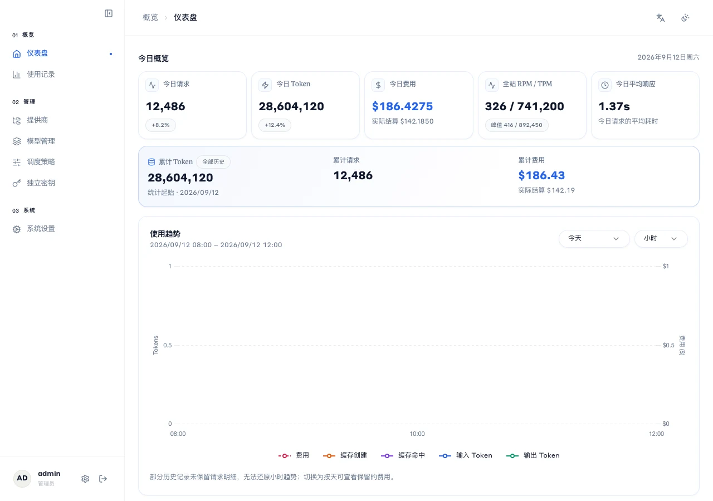
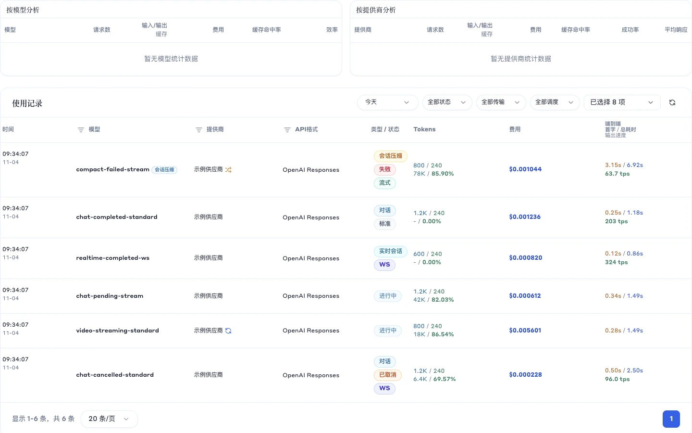
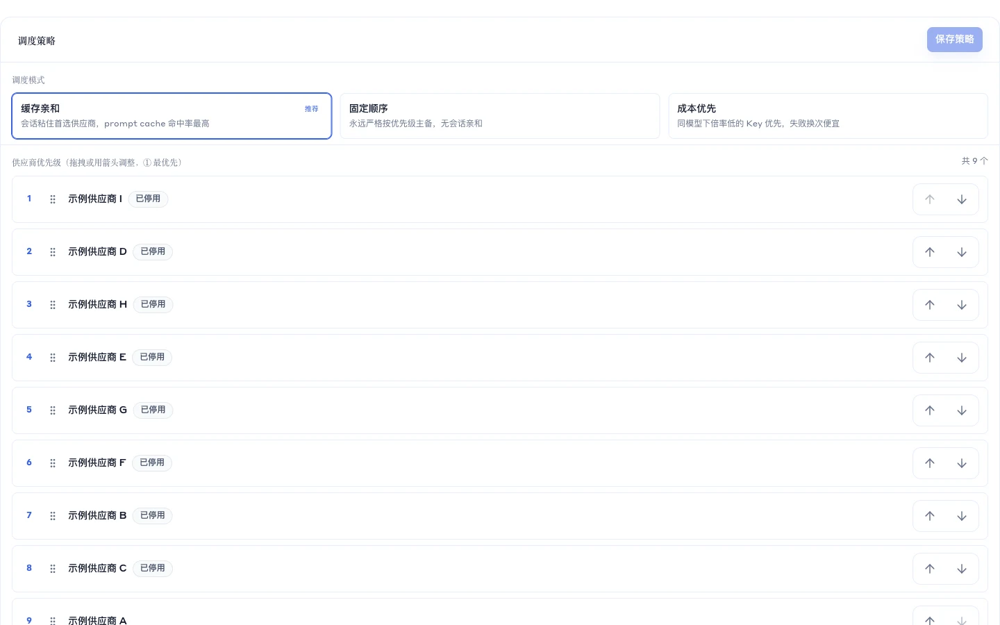
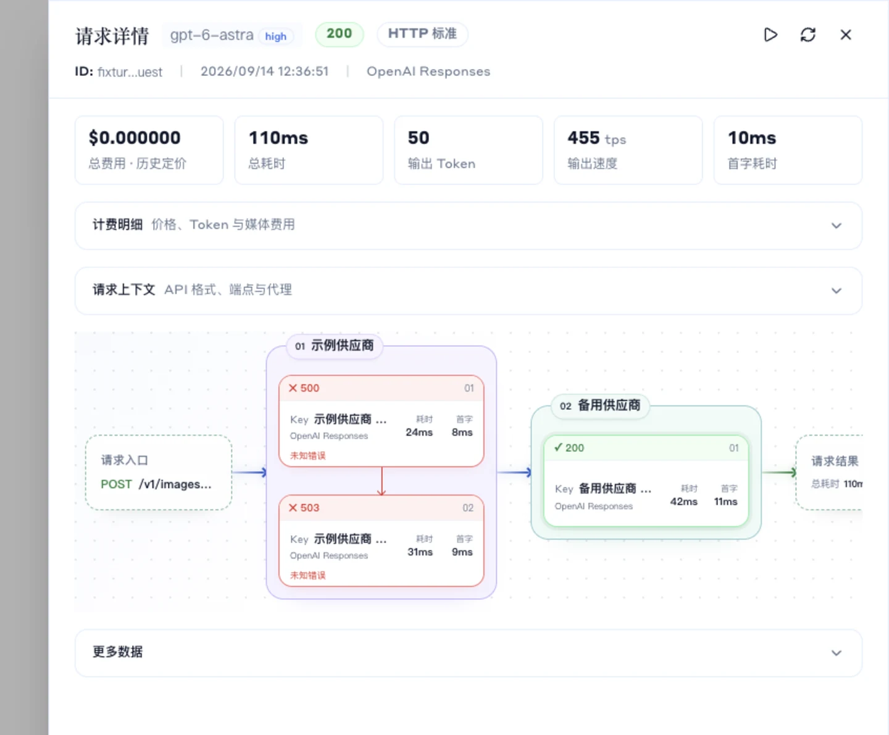
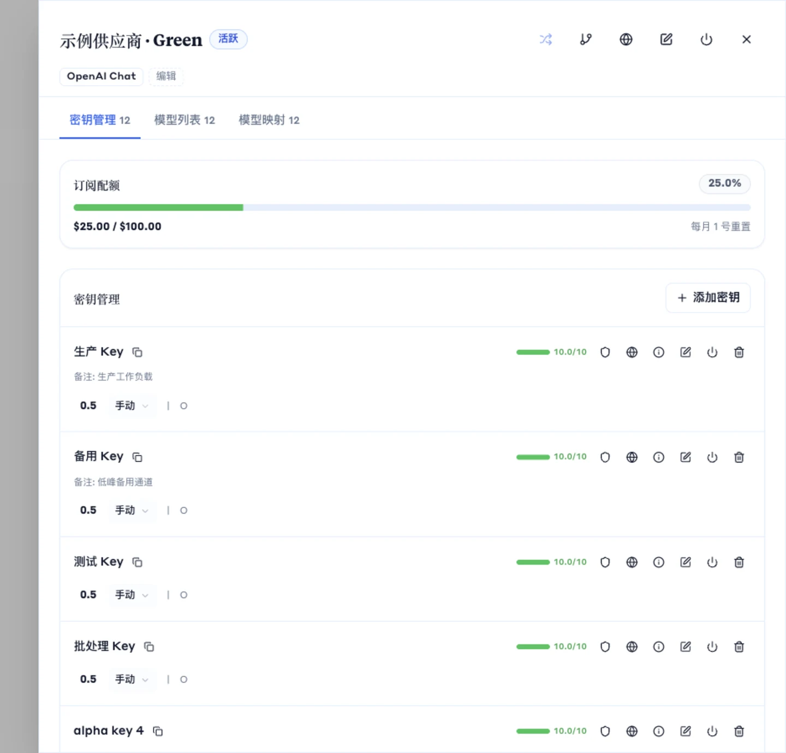
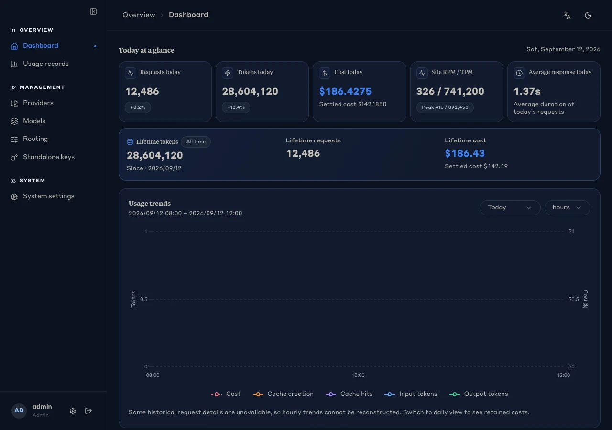

<p align="center">
  
</p>

<h1 align="center">Aether</h1>

<p align="center">
  <strong>把分散的 AI 供应商收进一个自托管入口。</strong><br>
  统一模型名、协议适配、故障转移、用量统计和成本分析，都在本机完成。<br>
  <sub>源码开放 · 单机优先 · 非商业许可</sub>
</p>

<p align="center">
  <a href="https://github.com/CodeZen-Lizhi/Aether/actions/workflows/rust-ci.yml">
    
  </a>
  
  
  
  <a href="LICENSE">
    
  </a>
</p>

<p align="center">
  <a href="#快速开始">快速开始</a> ·
  <a href="#核心能力">核心能力</a> ·
  <a href="#界面">界面</a> ·
  <a href="#部署与安全">部署与安全</a> ·
  <a href="#开发">开发</a> ·
  <a href="#文档">文档</a>
</p>



> 上图及本文其他界面截图使用合成数据，不含真实上游供应商、密钥、余额或请求内容。

## 项目定位

Aether 是一个面向个人和小团队的 AI API 网关，以 macOS 桌面客户端为主要交付形态，同时支持 Web、Docker Compose 和源码运行。它把不同供应商的端点与凭据收在本机服务后面，用统一模型名完成路由、协议转换、失败切换和用量记账。

项目采用单管理员、单节点优先的设计：SQLite 保存业务数据，内存运行时承载调度状态，不依赖外部数据库或 Redis。适合个人开发环境、小团队内部工具和需要自己掌控密钥与请求数据的场景。

**边界**

- Aether 不提供模型账号或第三方额度，只代理你实际配置的供应商。
- 协议转换遵循明确的能力边界；无法无损转换时会返回错误，而不是静默丢字段。
- 本地费用按模型价格和 Key 倍率估算，最终账单仍以供应商结算为准。
- 当前许可允许非商业使用；商业用途需要单独授权。

## 核心能力

### 统一模型入口

- 用稳定模型名屏蔽上游模型差异，再为一个入口配置多个供应商模型。
- 支持 OpenAI Chat Completions、Responses、Realtime、Images、Videos、Embeddings、Rerank 和 Search。
- 支持 Claude Messages、Gemini Generate Content、Gemini Interactions、Gemini Files 及对应流式接口。
- 在协议能力兼容时进行请求与响应转换；同格式请求可走原生透传，减少不必要的中间转换。

### 供应商、端点和 Key

- 一个供应商可配置多个端点、多把上游 Key 和多套模型映射。
- 支持 API Key、OAuth、Cookie 和自定义认证模板。
- Key 可设置模型范围、并发、RPM、过期时间、内部优先级与价格倍率。
- 支持余额、签到、月配额、分组倍率、端点健康和冷却状态。
- 模型测试与故障转移测试从真实候选链路发起，便于定位认证、模型名或上游兼容问题。

### 调度与故障转移

| 策略 | 调度依据 | 适合场景 |
| --- | --- | --- |
| 缓存亲和 `cache_affinity` | 同一会话优先复用供应商、端点和 Key | 长对话、编码助手等连续任务 |
| 固定顺序 `fixed_order` | 严格按供应商优先级主备 | 渠道少、顺序明确 |
| 成本优先 `cost_based` | 同模型下按 Key 价格倍率升序 | 渠道多、关注实际成本 |

调度会过滤已禁用、模型或接口不匹配、熔断未到探测时间以及本地容量不足的候选；候选失败后继续尝试下一项，并记录真实调用路径。流式请求共享首输出预算，开始有效输出后不会因该预算截断正常回答。

### 客户端访问控制

- 独立 API Key 可设置余额、有效期、并发和分钟级限速。
- 支持模型、供应商、IP/CIDR 与通配符白名单。
- 支持到期禁用或自动删除，以及默认限速和格式转换开关。
- 列表只显示脱敏 Key；创建后的完整值仅在首次结果中提供。

### 用量、成本与诊断

- 仪表盘展示今日请求、Token、费用、缓存、RPM/TPM 和平均响应时间。
- 使用记录可按时间、模型、供应商、协议、状态和传输类型筛选。
- 请求详情展示计费、Token、首字耗时、总耗时、吞吐和真实调度链路。
- 可查看请求头、请求体、响应体、原始上游错误、curl 回放和诊断信息。
- 支持按模型、供应商、接口格式和时间周期聚合统计分析。

### 桌面优先，默认留在本机

- macOS 14+，Apple Silicon 为主要交付目标；Tauri 2 宿主内打包 Rust 网关、SQLite 与前端资源。
- 安装后自动初始化并打开后台，无需额外创建管理员或经过 Web 登录页。
- 菜单栏支持启动、停止、重启、打开后台、数据目录、日志目录和退出。
- 网关默认只监听 `127.0.0.1`；JWT 与加密密钥保存在 macOS 钥匙串。
- 升级前生成数据库与 WAL 快照，并支持配置导入导出和完整备份恢复。

### Aether Tunnel

- 独立代理节点适合无法直连 Aether 或需要固定出口的网络环境。
- 节点通过 WebSocket 回连网关，无需向公网暴露监听端口。
- 支持多服务地址、自动重连、连接池、退出代理、DNS 与 IPv4/IPv6 策略。
- 管理页可查看节点指标、测试连通性并维护远程配置。

### 备份与恢复

- 配置导入导出覆盖供应商、端点、Key、模型、代理节点、调度策略和系统配置。
- 完整备份同时包含管理员资料、API Key 和用量数据。
- 默认使用 `skip / overwrite / error` 合并模式；冲突或无法关联的数据会明确中止。
- 桌面升级和恢复流程保留数据库文件组、普通配置与钥匙串密钥的边界说明。

## 界面

<table>
  <tr>
    <td width="50%"><strong>使用记录</strong><br></td>
    <td width="50%"><strong>调度策略</strong><br></td>
  </tr>
  <tr>
    <td width="50%"><strong>请求链路</strong><br></td>
    <td width="50%"><strong>供应商工作台</strong><br></td>
  </tr>
</table>

<details>
  <summary>查看深色主题</summary>
  <br>
  
</details>

## 架构

<p align="center">
  
</p>

请求从统一 API 入口进入后，依次经过鉴权、模型解析、候选调度、协议适配、上游传输和结果记账。调度状态、健康度、缓存与用量分别由独立模块维护，管理后台通过本机 HTTP 同源 API 访问网关。

```text
客户端
  │  OpenAI / Claude / Gemini / WebSocket
  ▼
Aether Gateway
  ├─ 客户端 Key 鉴权、限速与模型权限
  ├─ 全局模型解析与供应商模型映射
  ├─ 缓存亲和 / 固定顺序 / 成本优先调度
  ├─ 协议转换、透传、流式转发与重试
  └─ 用量、计费、健康度与请求诊断
  │
  ▼
已配置的上游供应商与 Key
```

### 兼容入口

| 能力 | 默认路径 |
| --- | --- |
| OpenAI Chat Completions | `POST /v1/chat/completions` |
| OpenAI Responses | `POST /v1/responses` |
| OpenAI Responses WebSocket | `GET /v1/responses`（协议升级） |
| OpenAI Realtime | `GET /v1/realtime`（协议升级） |
| OpenAI Embeddings | `POST /v1/embeddings` |
| OpenAI Images | `POST /v1/images/generations` |
| OpenAI Videos | `POST /v1/videos` |
| Claude Messages | `POST /v1/messages` |
| Gemini Generate Content | `POST /v1beta/models/{model}:{action}` |
| 模型列表 | `GET /v1/models` |
| 健康检查 | `GET /v1/health` |

具体字段支持以供应商能力和当前协议契约为准。Aether 不保证跨格式转换可以覆盖供应商的全部扩展字段。

## 快速开始

### macOS 桌面版

需要 macOS 14+、Xcode Command Line Tools、Rust 工具链，以及 Node.js 20.19+ 或 22.12+。

```bash
git clone https://github.com/CodeZen-Lizhi/Aether.git
cd Aether

npm --prefix frontend ci
npm --prefix apps/aether-desktop ci
npm --prefix apps/aether-desktop run build
```

产物位于：

```text
target/release/bundle/macos/Aether.app
target/release/bundle/dmg/
```

默认使用 ad-hoc 签名，不包含 Apple 公证。需要在本机反复重建并稳定复用钥匙串密钥时，先初始化个人签名身份：

```bash
npm --prefix apps/aether-desktop run signing:setup
```

详细安装、数据目录、备份、签名和故障恢复见 [macOS 客户端文档](docs/desktop-macos.md)。

### Docker Compose

```bash
cp .env.example .env
./generate_keys.sh
# 在 .env 中设置 ADMIN_PASSWORD 和必要的密钥

docker compose up -d --build
```

本机访问地址为 `http://127.0.0.1:8084`，SQLite 数据保存在 Docker named volume `aether-personal_aether-data`。Compose 默认把端口发布到宿主机网络接口；公网部署前必须补充 HTTPS、访问控制和防火墙。`docker compose down` 保留数据卷；确认不再需要数据后再使用 `docker compose down -v`。

### 源码运行

```bash
npm --prefix frontend ci
npm --prefix frontend run build
cargo run -p aether-gateway --release
```

首次启动前至少设置 `JWT_SECRET_KEY`、`ENCRYPTION_KEY` 和 `ADMIN_PASSWORD`。默认网关地址为 `http://127.0.0.1:8084`，OpenAI 兼容 Base URL 为 `http://127.0.0.1:8084/v1`。

## 使用流程

1. 启动桌面应用或网关，打开管理后台。
2. 添加供应商、端点和上游 Key。
3. 发现上游模型或手动建立供应商模型。
4. 创建统一模型，并关联一个或多个供应商模型。
5. 选择调度策略并调整供应商优先级。
6. 创建一个供客户端使用的独立 API Key。
7. 把客户端的 Base URL 指向 Aether，在 `Authorization` 头中使用该 Key。
8. 在使用记录中核对实际供应商、Token、费用和失败原因。

## 部署与安全

- 桌面模式固定监听本机 IPv4 回环地址，并自动建立本机会话。
- 在 Docker 或源码模式把服务暴露到非回环地址前，应配置 HTTPS 反向代理、访问控制和防火墙。
- 上游凭据由应用加密保存；桌面主密钥在 macOS 钥匙串，Web/Docker 主密钥来自环境变量。
- 更换 `ENCRYPTION_KEY` 前先导出备份并验证恢复方案；丢失原密钥后，已有密文无法解密。
- 配置和完整备份可能包含上游凭据、管理员资料与请求数据，应视为敏感文件保管。
- 不要提交 `.env`、数据库、日志、导出文件或包含真实凭据的截图。
- 完整环境变量示例见 [`.env.example`](.env.example)。

## 开发

```bash
make dev           # 后端 + 前端开发服务
make dev-backend   # 仅后端
make dev-frontend  # 仅前端
```

常用检查：

```bash
npm --prefix frontend run type-check
npm --prefix frontend run test:run

cargo fmt --all -- --check
cargo check -p aether-gateway
cargo test -p aether-gateway --lib

npm --prefix apps/aether-desktop test
```

桌面交付涉及构建产物验证时，优先使用项目提供的 `verify:delivery` 或 `build:verified`。普通 `build` 只证明安装包构建成功，不替代功能验收。

## 项目结构

```text
apps/
  aether-desktop/      Tauri macOS 宿主、打包与交付脚本
  aether-gateway/      HTTP/WebSocket 网关入口
  aether-tunnel/       独立代理节点程序
crates/
  aether-ai/           协议格式、转换、规划与 serving
  aether-provider/     供应商、端点、Key 与传输
  aether-routing-core/ 调度规则
  aether-gateway/      前门、控制、执行与 worker
  aether-data/         SQLite、查询、Schema 与迁移
  aether-usage/        用量、统计与结算
frontend/              Vue 3 管理界面
docs/                  规范、架构、任务与运维文档
```

## 文档

- [Spec 索引](docs/specs/index.md)
- [macOS 客户端](docs/desktop-macos.md)
- [聊天调度与故障转移](docs/specs/aether-gateway/backend/chat-failover.md)
- [调度策略配置](docs/specs/aether-routing-core/backend/simplified-routing.md)
- [配置备份与导入](docs/specs/aether-gateway/backend/admin-json-backup.md)
- [API 格式透传与转换](docs/api/format-passthrough-contract.md)
- [Responses WebSocket 模式](docs/WebSocket-Mode.md)
- [Aether Tunnel](apps/aether-tunnel/README.md)

## 贡献

提交 Issue 或 Pull Request 前，请阅读 [CONTRIBUTING.md](CONTRIBUTING.md)。安全漏洞不要公开提交 Issue，按 [SECURITY.md](SECURITY.md) 的方式私下报告。

## 许可证

本项目使用 [Aether 非商业开源许可证](LICENSE)。允许个人学习、研究、教育、非盈利组织和企业内部非盈利性质的使用；售卖本软件、使用本软件提供付费服务或其他盈利用途需要单独授权。

当前许可证并非 OSI 定义的开源许可证，因此 Aether 应表述为“源码开放、非商业许可”项目。
