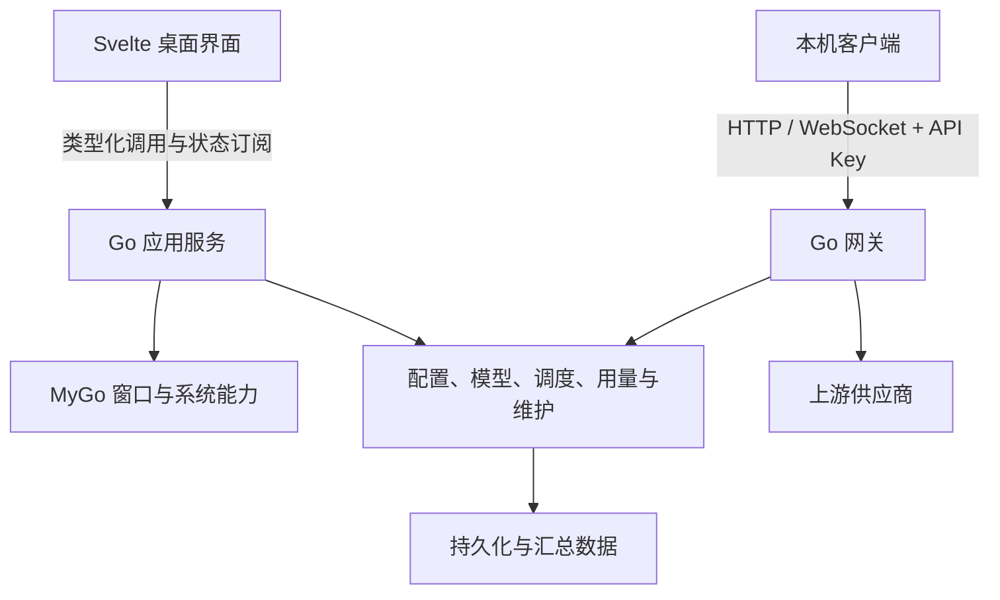

# Aether 桌面版整体重构方案

状态：持续讨论中的方案草案；产品方向与部分规则已确认，第一轮独立浏览器 UI / UX 原型已有验证；Vela 模型管理第一阶段已实施并验证核心闭环，且已接入仅本机 OpenAI Chat 网关供 Aether 作为真实供应商调用；其余模块继续按确认范围推进。

创建：2026-11-07。最近更新：2026-11-12。

## 1. 文档用途与当前授权

本文是本次重构讨论的总入口，维护整体目标、跨模块决定、候选设计与验收；已独立成文的模块需求由对应文档维护，本文保留引用入口。

- 用户已授权整理文档，并在后续讨论中持续更新。
- 用户现已明确授权按任务导航制作第一轮可操作浏览器原型，用模拟数据确认功能、页面与流程；范围见[第一轮原型记录](ui-prototype.md)。该授权不包括 Go/MyGo 集成、真实网关、数据库重构、性能实现或正式产品打包。
- 用户已另行授权按已确认需求实施 Vela 模型管理第一阶段，包含 Go/MyGo 绑定、SQLite、真实目录、正式前端及必要构建和本机验证；具体范围与证据见[模型管理需求](model-management.md)。
- 2026-11-12 用户要求将 Vela 作为 Aether 的真实供应商接入并完成实际调用，以 Vela 当前模型页全部模型分担现有网关请求；本次实现和证据见[模型管理需求第 8 节](model-management.md#仅本机-openai-chat-网关与-aether-真实接入2026-11-12)。
- 用户已于 2026-11-11 确认并授权实施 R53 本地凭据保护：更新整体 PRD、迁移已有网关访问密钥并接入本地加密存储。
- 第 3 节是已确认要求；第 5 节记录技术设计，指纹检测见第 5.8–5.9 节，轻量访问凭据见第 5.11 节，确认范围以各节标记为准；第 8 节是未决问题。候选与未决内容不能当作已确认规则。
- 本文描述未来目标，不证明当前软件已有相应能力，也不证明重构、性能优化或验收已完成。
- 现行行为仍以当前源码和对应 [Spec](../../specs/index.md) 为依据。本文不覆盖现行系统规范，后续规则变化明确记录后再同步。
- 重构以旧版为默认业务基线：未提及或表述不清的需求按旧版核对迁移，明确新版要求只覆盖对应范围。供应商前端结合已认可 UI、后端结合旧版与模块 PRD；主要差异及精简边界统一见 [供应商管理需求第 2.1～2.1.1 节](provider-management.md#21-迁移依据与优先级2026-11-11-收口)，不因页面展示优化重设计整套后台业务。
- 请求记录（导航“使用记录”）的模块需求与验收见 [RR：请求记录](request-records.md)。2026-11-12 用户已确认本批筛选、实时、摘要/折叠分析、默认分页与历史名称规则，并明确授权在独立 Worktree 开发；已接入现有调度和诊断执行链，实际验收与正式网关覆盖边界见 Vela `docs/request-records-delivery.md`。本文 R09～R22、R28、R42、R49～R51、R53 等已确认规则继续有效；独立未决项保留在 RR-Q05。

## 2. 背景、现状与目标

### 2.1 背景与已知事实

用户希望整体重构软件，大部分功能迁移，并在性能、安装包体积和功能体验上改进；允许重做全部表结构与模块结构。

用户描述的问题包括：安装包大、启动慢、常驻内存高、界面卡顿、刷新慢或不自动刷新，以及代理延迟、并发和历史查询方面的优化需求。这些是需求来源，尚无统一环境下的量化基线，不能据此断言具体根因。

当前项目资料与配置显示：

- 当前技术栈为 Rust、Tauri 2、Vue 3 和 SQLite。
- 桌面宿主管理独立网关进程；当前还提供 Web、Docker 等使用方式。
- 当前主要导航包括仪表盘、使用记录、供应商、模型管理、调度、调用 Key 和系统设置。
- 当前仪表盘在进入页面与修改时间筛选时取数，使用记录页已有多种轮询机制。这里仅做静态阅读，未实际复现全部刷新问题或完成性能归因。

定位依据： [README](../../../README.md)、[桌面打包配置](../../../apps/aether-desktop/src-tauri/tauri.conf.json)、[当前前端依赖](../../../frontend/package.json)、[导航](../../../frontend/src/layouts/main-layout/navigation.ts)、[路由](../../../frontend/src/router/routes/admin.ts)、[仪表盘](../../../frontend/src/views/shared/Dashboard.vue)、[使用记录](../../../frontend/src/views/shared/Usage.vue)。

### 2.2 重构目标

1. 构建面向本地使用的轻量 AI 网关客户端，提升启动、交互、刷新、并发代理和历史查询体验。
2. 控制完整安装包体积、安装后体积及应用运行时总资源占用。
3. 重新整理功能与数据关系，减少历史兼容负担，同时尽量完整覆盖当前可用业务能力。
4. 通过可重现的业务与性能场景判断改善效果，不能以更换语言、框架或构建成功代替结果。

## 3. 已确认要求

下表的确认依据均为本次讨论中的用户明确选择；标记为待定的数值与实现不属于已确认范围。

| 编号 | 事项 | 已确认规则 |
| --- | --- | --- |
| R01 | 技术方向 | Go + MyGo 桌面宿主；前端确定为 Svelte 5 + TypeScript + Vite + Tailwind CSS 4 + shadcn-svelte。基础控件采用 shadcn-svelte 的 Svelte 组件源码，按需引入并统一主题；业务布局和复杂展示按需求组合。Svelte 替代最初讨论的 React，具体依赖版本与完整技术组合仍需后续代表性原型验证。 |
| R02 | 首期平台 | 首期仅支持 Apple Silicon macOS；保留未来跨平台空间，Intel 后续考虑。最低 macOS 版本待定。 |
| R03 | 交付形态 | 首期只交付桌面客户端；内部保留未来独立运行网关的空间。独立 Web 管理与 Docker / 无界面部署不纳入首期交付。 |
| R04 | 功能范围 | 现有可用功能尽量全部纳入首期，接受更长重构周期；已明确取消独立余额密钥模块，按 R34–R35 精简为网关访问凭据。其他迁移与取舍依据第 4 节逐项核对。 |
| R05 | 界面与流程 | 整体重新设计界面、导航和操作流程。具体页面组织、交互与视觉尚未确定。 |
| R06 | 数据与结构 | 允许全新开始，不要求迁移旧数据；允许重新设计数据表与模块结构。保留公司/个人电脑间搬运配置的导入导出；取消包含调用历史与统计的完整备份及整库恢复。升级与凭据保护仍需设计，配置搬运边界见 R45。 |
| R07 | 外部工具调用 | 保留桌面版供其他工具使用的 HTTP / WebSocket 网关能力；默认客户端协议按 R37，其他协议与媒体能力按功能盘点确认。 |
| R08 | 网络访问 | 网关仅监听 127.0.0.1，仅供本机客户端调用；取消本机/局域网切换及局域网接入，取消 Tunnel 远程访问。端口可修改，本机调用仍使用 R35 的单个访问密钥；管理界面保留在桌面客户端内。 |
| R09 | 定时与实时刷新 | 仪表盘定时刷新汇总数据；供应商列表定时刷新余额、倍率等信息；使用记录提供可选的实时刷新模式。已展示的进行中请求持续更新到最终结果。账户信息刷新、两类查询配置与各 Key 的名称/倍率来源统一见 [PM-R11～PM-R13](provider-management.md)。请求记录的实时默认值、记忆与周期按 [RR-R03](request-records.md#rr-r03刷新与进行中收尾) 执行；其他页面刷新周期仍待定。本条替代最初“只自动更新仪表盘和进行中请求”的范围限制。 |
| R10 | 使用记录查询 | 进入页面、手动刷新或调整查询条件时获取记录；关闭实时模式时不定时自动插入新记录，窗口恢复显示的立即刷新遵循 R22。开启实时模式仅第一页插入，后续页保持阅读位置，已展示进行中请求持续收尾；详见 [RR-R03](request-records.md#rr-r03刷新与进行中收尾)。 |
| R11 | 正文保留 | 请求与响应文本正文沿用 7 天的内置保留期限，从请求结束起算；不再提供采集开关或期限表单，进行中请求不按期限清理。到期后仍可在 R12 的 30 天范围内查询请求摘要；不能通过诊断引用绕过正文期限。 |
| R12 | 请求明细保留 | 只保留最近 30 天的请求明细，包括时间、模型、状态、Token、费用和耗时等摘要；期限从请求结束起算，进行中请求不删。到期自动清理，累计请求数、Token、费用及 R19 的长期维度统计独立保留。取消摘要永久保留及可配置保留期限，提供显式确认的手动清理入口。本轮原型不立即删除既有数据，也不伪造自动清理已运行。 |
| R13 | 清理与统计 | 手动或自动到期清理请求后保留长期统计，只删除可检索明细。正文到期清理不影响统计；累计请求数、Token 与费用应继续可用。 |
| R14 | 首轮规模 | 20 个并发请求，包含长时间流式请求；100 万条历史摘要。请求大小、持续时间、数据分布和硬件条件待定义。 |
| R15 | 数值性能门槛 | 启动、内存、交互、查询、代理开销和包体积的数值指标，在代表性原型实测后确定，当前没有已承诺阈值。 |
| R16 | 实施时机 | 当前持续完善方案，并已授权先制作独立的第一轮浏览器 UI / UX 原型，采用任务导航与模拟数据确认功能和交互；不启动后端或 MyGo 性能原型。正式重构按模块另行启动：模型管理第一阶段已于 2026-11-10 启动并实施，供应商管理已于 2026-11-11 启动；其余模块仍等待明确启动。 |
| R17 | 诊断明细 | 完整调度尝试、详细上游错误及脱敏后的请求/响应头沿用 30 天内置期限，不提供独立采集或期限设置；正文受 R11 更短期限约束。随 R12 到期清理请求明细，错误排查入口仍位于使用记录详情。 |
| R18 | 媒体采集 | 内置只保存文本与媒体元信息，不保存媒体二进制或完整内嵌 base64；取消完整媒体采集选项，不承诺缺少媒体的请求可完整回放。 |
| R19 | 长期统计维度 | 清理请求明细后，仍支持按日、供应商、统一模型、协议查询请求数、Token 和费用，并支持这些维度的组合筛选。按 R35 改为单个网关访问密钥，不提供多个调用凭据的统计分组；上游 Key 的归属继续保留。其他指标和更细时间粒度待盘点。 |
| R20 | 历史实体归属 | 供应商、模型、上游 Key 改名后，历史统计统一显示当前名称；删除后保留最后名称并标记“已删除”；重建同名实体按不同身份单独统计。单条诊断中请求发生时名称的展示规则另行设计。 |
| R21 | 统计时区 | 每日统计在首次使用时取本机时区，之后固定，不随系统时区自动变化。手动修改统计时区的规则待定。 |
| R22 | 窗口恢复刷新 | 窗口从最小化或隐藏状态恢复为可见时，立即触发当前页面的数据刷新；使用记录关闭实时模式时也适用。无需切换页面或手动点击刷新。普通窗口聚焦与最大化尺寸变化是否触发，仍需区分。 |
| R23 | 模型指纹检测 | 纳入新版诊断功能，支持用户手动触发及按供应商配置的定时任务；Go 侧执行采样与本地评分，界面展示进度和结果。正常代理请求本身不额外触发指纹检测。 |
| R24 | 检测核心与请求复用 | 优先复用固定版本的 lm-detector Go 题目生成、解析与评分实现，采样复用 Aether 的认证、代理、流式读取与取消能力；不为此功能引入额外 Python、Bun 或 Node 运行环境。固定 Go SDK 依赖或内置最小核心的方式待实现评估。 |
| R25 | 检测目标与结果边界 | 一轮检测固定供应商、端点、Key 和实际请求模型，不自动切换到其他目标混合采样。结果表达参考库内的统计相似性，不能当作身份认证或仅凭结果认定渠道造假。 |
| R26 | 检测数据版本 | 应用附带与算法配套的固定参考数据，使用检测或重新分析时按需加载；不在启动时解码加载，不沿用上游默认的后台数据自动更新。数据更新由 Aether 明确管理，显示版本。 |
| R27 | 检测性能与操作体验 | 支持采样进度和取消，合并频繁进度更新；限制检测并发，避免占满上游连接或额度；检测数据只在 Go 侧保留一份，任务结束或取消后释放任务资源。并发数、缓存时长及性能门槛待测量。 |
| R28 | 检测报告与费用 | 保存检测目标、时间、算法和数据版本、样本状态及结果；检测请求标记为诊断请求，实际消耗照常记录，日常业务统计可区分查询。取消不能保证撤销已发出请求的费用；报告与样本的保留规则待定。 |
| R29 | 供应商定时检测与 Key 覆盖 | 每个模型独立选择该模型执行的启用且兼容 Key，默认全选，可逐模型缩小；不得把多个模型的 Key 集合当作一个全局范围再做笛卡尔合并。每个固定组合由供应商、端点、Key、实际模型、协议和思考强度共同确定，三条样本独立评分，不自动更换其中任一条件。停用、删除或不兼容的组合不继续发请求，覆盖状态明确显示。此条替代原固定首个 Key 规则。 |
| R30 | 密钥健康与验证分工 | 供应商配置、展示与生命周期规则统一见 [供应商管理需求 PM-R05、PM-R15](provider-management.md)；模型验证执行、结果身份和报告见 [模型验证需求](model-verification.md)。此处仅保留索引，不维护第二份规则。 |
| R31 | 定时检测模型与周期 | 按供应商勾选监测模型，不默认遍历全部模型；每个模型分别绑定 Key 和思考强度，结果按模型、Key、端点、实际模型、协议及思考强度分别归属。定时计划默认关闭，开启后默认每 6 小时一轮，可调整；一轮覆盖所选固定目标，每个组合采样 3 次。 |
| R32 | 供应商模型验证列 | 供应商配置、展示与生命周期规则统一见 [供应商管理需求 PM-R01、PM-R15](provider-management.md)；模型验证执行、结果身份和报告见 [模型验证需求](model-verification.md)。此处仅保留索引，不维护第二份规则。 |
| R33 | 定时检测运行与补测 | 窗口最小化或隐藏时已启用计划继续运行；电脑睡眠或应用退出时不执行。恢复或重新启动后若错过周期，每个计划只合并补测一轮，不逐周期补跑，之后继续按计划周期计时；一轮覆盖所选模型、Key 与思考强度范围内的固定组合，仍分批执行。 |
| R34 | 取消独立余额密钥模块 | 新版取消独立余额 API Key 的顶级页面及内部钱包、充值、余额分配/扣减逻辑；外部调用不以内部钱包余额为前提。供应商实际余额、上游配额监控及请求费用/Token 统计继续按各自业务保留。 |
| R35 | 单个网关访问密钥 | 个人工具首期只提供一个网关访问密钥，所有客户端共用；“设置 → 接入与访问”支持修改、复制与显示/隐藏密钥，默认掩码；密钥持久化必须加密，不得写入普通配置、日志或明文导出，保存失败保留旧值。保留 R08 的本机调用鉴权。不提供多凭据创建、命名、列表、启停、撤销及按凭据分析；暂不加入密钥级额度、金额、限速、并发、有效期或模型/IP 权限限制。上游 Key 管理、多 Key 调度、健康与检测仍在供应商内。本条替代此前具名多凭据管理方案。 |
| R36 | 应用使用形态 | 采用“后台服务默认运行＋完整主窗口”：应用启动且具备运行所需配置时默认启动网关服务，主窗口承载完整管理能力。关闭窗口后的后台运行/退出及菜单栏、Dock 入口按 R43 设计；复杂菜单与快捷功能仍暂缓，不预设独立系统服务。 |
| R37 | 默认客户端协议与接入展示 | 网关默认同时支持 OpenAI（Chat Completions）、Responses（OpenAI Responses）、Anthropic（Messages）、Gemini（generateContent）四种客户端协议，无需全局单选启用。接入信息区展示一个网关根地址和 R35 的单个访问密钥，均可复制；监听配置按 R38 同页管理；移除协议切换、支持协议数量、配置及调用示例。客户端所需的 API 路径按对应格式处理，单一入口不表示所有 SDK 的 Base URL 路径约定相同。 |
| R38 | 监听与接入信息同页 | 设置单页中的“网关接入”区按“固定监听地址 127.0.0.1 与可编辑端口 → 接入地址 → 单密钥”组织，无访问范围或监听接口切换，无 Tunnel 远程访问入口。端口先编辑草稿，保存成功后更新可复制地址，取消、校验或绑定失败保留原配置和地址。网络代理不重复监听配置。 |

| R39 | 供应商单地址与默认兼容 | 规则已移入 [PM-R14](provider-management.md#314-pm-r14供应商单地址与默认兼容原-r39)。网关按该约束接入四种格式；同格式转发与必要兼容仍见 R40、R52。 |
| R40 | 默认接入不做跨格式转换 | 在 R39 前提下，同格式原生转发，不需要转换开关；取消供应商和全局的跨协议转换配置。上游内部是否转换由上游决定；失败不自动改格式重试。以后如增加只支持单一格式的直连服务，再单独讨论适配与转换范围，不预留当前配置入口。 |
| R41 | 全局设置与功能配置归属 | “网络代理”只配置全局代理开关及地址，不展示代理节点名称/地区列表、“默认出口”或“在线模型目录出口”。在线价格目录不提供独立网络设置，始终跟随全局代理：全局代理开启时使用全局代理，关闭时直连。供应商及 Key 的局部代理仍只在供应商内配置，局部代理不改全局。Tunnel 按 R08 取消，不再移动或保留隐藏入口。 |
| R42 | 数据管理精简 | 设置页不展示正文/诊断期限、记录级别、可编辑脱敏头及完整媒体采集等细项，采集按内置规则执行。请求明细 30 天、累计统计持续保留，只提供清理入口；配置导入导出按 R45 保留，完整备份/恢复取消。清理预览并确认，只删所选已结束请求明细，保留进行中、供应商、模型、密钥、应用配置、验证报告及累计统计。 |
| R43 | 应用偏好精简与窗口行为 | 开机启动作为独立明显选项；关闭窗口后可选择继续运行网关或退出应用，后台运行时可选择仅菜单栏、仅 Dock 或两者，始终保留重新打开入口。退出应用停止网关，关闭窗口继续运行不等于退出。原型先采用开机启动关闭、关闭窗口继续运行、仅保留菜单栏，具体默认值供评审。保留外观、语言及页面刷新，去掉抽象的“后台服务默认运行”状态项；移除图像请求心跳、非流式文本心跳与中断续传配置，首期不实现这些附加机制。跨格式规则沿用 R39–R40，不新增全局开关。 |
| R44 | 总览关注范围与设置 | 总览罗列已启用调用链路上的余额不足、模型验证差异、供应商健康异常与 Key 倍率升降，事项不跳转。健康仅按供应商聚合结果展示，不生成 Key 健康提醒；Key 级只产生倍率升降。四项提醒默认开启并可在“设置 → 日常使用 → 总览提醒”独立关闭，统一余额阈值原型默认 $10、可编辑，并提供恢复默认。任一开启且存在事项时显示完整关注面板；有开启项但无事项时只显示一行无事项状态；四项全部关闭时总览隐藏该模块，设置页入口保留。总览原有“关注设置”快捷入口复用同一编辑器。开关仅控制展示，不启用采集或验证任务。范围按供应商/Key 启用及兼容模型确定；停用、删除、不兼容资源不纳入。余额、供应商健康恢复与最新验证无差异后自动移除。倍率须有已知前后值，每把有效 Key 展示最近一次未读变化，标为已读后移除；原型在本地保存偏好、基线和未读状态，刷新可恢复，真实采集来源仍待实现。保留明细弹窗、合计趋势、维度分布与年度热力图。 |
| R45 | 设置单页与配置导入导出 | 设置入口固定于左侧导航底部，进入后展开“常规、接入与访问、账户、网络代理、总览提醒、记录管理”子分类（“账户”承载 R09 的全局账户信息刷新开关与间隔）；同一时间显示一个分类，常规按左侧名称、右侧控件逐行排列，分类切换保留草稿。导入导出用于公司与个人电脑复用供应商、上游 Key 配置、模型映射及调度方案，不包含调用历史/正文/报告/累计统计或本机网关密钥；端口、网络与窗口偏好保留本机值。导入先校验和数量预览，明确替换资源配置，取消或失败不写入；没有对应节点的专用代理跟随本机设置。保留独立开机启动及关闭窗口选择，不重新引入正文采集细项或整库备份。 |
| R46 | 模型主页面 | 规则统一见 [MM-R01～MM-R04、MM-R06](model-management.md)：统一清单、目录添加、类型筛选、详情/编辑、删除与同步；本地改价及修改保护按当前有效修订执行。目录外添加及额外元数据编辑仍待确认。 |
| R47 | 模型标准价格与类型 | 规则统一见 [MM-R05、MM-R07](model-management.md)：完整类型价格、上下文/Fast/分时组合、供应商倍率分工与历史价格快照；具体未决边界见 MM-Q03～MM-Q07。 |
| R48 | 供应商主列表与详情分工 | 供应商配置、展示与生命周期规则统一见 [供应商管理需求 PM-R01～PM-R10、PM-R15](provider-management.md)；模型验证执行、结果身份和报告见 [模型验证需求](model-verification.md)。此处仅保留索引，不维护第二份规则。 |
| R49 | 使用记录字段与操作 | 列信息以用户提供的原 APP 截图为准：时间上下两行显示时分秒与完整年月日；模型显示名称、已记录的思考强度/非默认处理层级及不同的实际上游映射名；提供商显示最终供应商与执行 Key，并可就地展示转移/重试标记；API 格式独立成列；状态只显示一个最终结论：`成功`、`失败`、`未发上游`、`进行中`。本地熔断归入`未发上游`，具体原因只放提供商状态和详情，禁止重复写“请求完成”“上游失败”等副标题；类型只显示业务类型与传输方式，例如`对话 / 流式`，不得把按图片计费混入类型。原 Tokens 列命名为“用量”，固定展示 `Token 按量 / 图片按次` 口径；Token 保持两行斜杠格式，第一行为输入/输出，第二行为缓存读取/命中率，不增加重复文字标签；图片请求显示数量、按次和规格；未发上游只显示轻量`— 无用量`。费用只显示六位小数美元金额；端到端保持两行斜杠格式，第一行为首字/总耗时，第二行为输出速度，不加重复文字标签；未发上游显示`本地响应 + 实际耗时`，禁止重复写“本地拦截 / 未请求上游”。当前仅使用合成数据展示 UI，正式前后端计算口径后续实现；缺失保持未知。移除重放功能，列表与窄屏卡片保留详情，详情内也不再提供重放入口。 |
| R50 | 按次计费与本地熔断展示 | 使用记录必须区分 Token 按量与非 Token 按次计费：图片请求在“用量”位置显示数量与单位（例如“1 张”），并显示`按次`和`1024×1024 · medium`等规格，详情显示按图片计费、数量、规格和质量，不伪造输入/输出 Token。上游失败导致 Key 熔断后，后续未发送上游的请求在状态列统一显示“未发上游”，具体原因“本地熔断”只放提供商状态和请求详情；用量显示独立的“无用量 / 请求未到上游”空状态。状态筛选和请求去向筛选均可只看未发上游或只看已请求上游。本地熔断详情必须说明请求只到 Aether、没有上游 HTTP 响应，并保存和展示触发熔断的上游请求 ID、HTTP 状态及原始错误正文。当前原型只实现展示与合成数据；正式原子记录、熔断关联和前后端计算另行实现。 |
| R51 | 模型映射与筛选布局 | 模型身份、思考强度、非默认处理层级和实际映射按 R49 展示；2026-11-12 用户明确选择最新 Svelte 原型筛选布局，具体规则统一见 [请求记录 RR-R01 与第 4 节](request-records.md)。该决定替代原时间列起止日期、供应商菜单内执行路径等筛选分组及显示列入口布局；不因布局变化取消未发上游查询与业务/诊断来源区分。其余待确认内容见 RR-Q01。 |

R01 代表已选定的技术方向；当前独立 UI 原型仍使用 Svelte 5、TypeScript、Vite 与自定义 CSS/组件，尚未接入 Tailwind CSS 4 和 shadcn-svelte。本轮确认并更新方案，不代表原型迁移或正式 Go/MyGo 技术组合已验证、锁版。若代表性技术原型不满足要求，应先说明证据、影响及替代建议，再讨论调整。

术语：新版“网关访问密钥”只用于客户端鉴权，首期只有一个；供应商侧“上游 Key”仍可有多把，用于执行、调度、费用归属与检测。R19–R20 的统计与历史规则不要求恢复多调用凭据管理。

### R52：Codex 独立上下文兼容（重构必须保留）

向供应商中转站转发 Responses 请求时，将缺少或空字符串 `call_id` 的 `function_call_output` / `custom_tool_call_output` 转为用户上下文，保留文字与图片，不伪造调用标识。正常带 `call_id` 的工具结果保持原样，不打断工具调用与结果的配对顺序，不改变 `previous_response_id`。覆盖首轮空页面快照和独立通知；非法标识与未知输出形状交由既有协议校验处理，不静默吞掉。

Codex Desktop 可能在首轮请求中自动注入 `agent.codex_apps_open_page`、`agent.codex_apps_selected_page_part_N_of_M` 等上下文，即使快照只有 `page_id: null`，也可能使用没有 `call_id` 的工具输出外形。部分中转站会因此在模型推理前返回 `function_call_output requires call_id`；报错提示中出现 `previous_response_id` 不足以证明请求使用了该字段。

此项是 R39–R40 同格式转发中的必要请求兼容，必须接入新版实际发送链路，不能因重写协议解析或请求整理而遗漏。当前 Rust 实现同时覆盖跨格式转换，但新版继续按 R40 不做跨格式转换；本条不恢复 Responses 转 Chat、原生账号接入或新增配置开关。实现可以重新组织，行为与验收必须保留。

迁移定位资料：

- [现行格式契约](../../specs/aether-ai-formats/backend/index.md)：长期行为约束。
- [归一化实现与回归测试](../../../crates/aether-ai/formats/src/formats/openai/responses/standalone_output.rs)、[最终请求整理入口](../../../crates/aether-ai/formats/src/formats/openai/request_contract.rs)、[同格式请求构造与回归](../../../crates/aether-provider/transport/src/same_format_provider/mod.rs)：迁移时核对实际调用链，不能只复制辅助函数而漏接发送入口。
- [现行实现与验证边界](../2026-11-10-codex-standalone-context.md)：现行源码测试记录，不代表新版 Go 网关或实际供应商链路已验收。

### R53：本地凭据保护与升级免重复授权（2026-11-11 已确认）

用户确认：凭据只保存在本机，加密落盘，不出现在普通配置、日志和默认导出中；防止误泄露及数据库单独泄露。对于已取得当前用户权限的恶意程序，不承诺能够阻止窃取。该规则适用于网关访问密钥、上游 API Key 以及后续接入的账户令牌等凭据；供应商模块引用本条，不维护另一套保护边界。

- 不以购买 Apple Developer Program 为前提；正常读取、修改凭据和应用更新后重读不依赖钥匙串，不因凭据读取反复要求电脑密码。不承诺消除未公证软件的 Gatekeeper、安装目录权限等系统提示。
- 本机随机主密钥与凭据密文分开保存，使用成熟的认证加密；专用凭据目录权限为 0700，文件权限为 0600。主密钥本身属于敏感材料，不随普通配置及默认导出搬运，不嵌入源码或安装包。
- 保护边界：直接查看数据库和普通配置不能得到 API Key 明文；同时取得主密钥与密文可以解密，文件权限不隔离同一用户下的其他程序。无需新增启动解锁密码，也不将文件加密宣传为系统钥匙串级应用隔离。
- 不上传到开发者服务器；实际请求只向用户配置的对应供应商发送必需凭据。默认列表及详情只返回掩码；网关访问密钥保留 R35 已确认的主动显示、复制与修改，上游 Key 主动复制由后端写入剪贴板。
- 旧 Vela 网关访问密钥按需从原钥匙串读取并加密保存；旧项不存在也持久记录迁移完成，后续不重复查询。首次迁移可能出现系统授权；拒绝、读取或保存失败时明确报错，可重试，不删除旧项或伪造迁移完成。隔离验收目录不读取日常钥匙串。
- 主密钥缺失、格式错误或密文损坏时明确失败，保留原数据，不自动生成替代密钥覆盖已有凭据。跨电脑加密搬运仍按 R45/Q08 独立设计，不能把复制数据库当作凭据导入；默认导出不包含凭据及主密钥。
- 这次实施覆盖现有网关访问密钥、供应商 API Key 及全局/供应商/Key 代理配置的加密落盘。已有代理 JSON 在模块初始化时迁移，失败保留旧值；不承诺擦除旧数据库页、历史备份或已产生的副本。后续账户查询、请求日志、配置导出等模块上线时必须按本条验收，不能以本次存储实现宣称这些尚未接入的功能已完成。

验收：在隔离目录通过真实应用服务保存网关访问密钥与上游 API Key，重新打开存储及服务后内容一致，列表无明文；检查数据库、凭据文件和普通配置不含测试 API Key 明文，权限符合要求。使用旧凭据读取回调验证迁移成功后不再调用旧存储、拒绝后可重试；移走主密钥或改坏密文后读取及覆盖必须失败，恢复原文件后可读。实际桌面构建启动、保存、退出并重启后仍能读取。真实用户旧钥匙串弹窗及未公证发布包跨机打开需单独记录证据，不能用回调测试冒充。

## 4. 功能迁移盘点

### 4.1 盘点方法

以下是依据当前 README、导航和规范入口整理的盘点基线，不是逐项通过实测的完整能力声明。每项后续需补充实际入口、当前有效契约、迁移决定、拟优化行为和对应验收。

迁移重点是功能与业务语义，不要求逐文件翻译旧代码或沿用旧页面。尚未确认取消的能力不能因语言切换、表结构调整或页面合并而自动删除。已移除的历史多用户、多数据库等结构，也不能仅凭旧表名或目录重新纳入产品。

| 编号 | 业务领域 | 待核对的现有能力 | 当前入口与资料 |
| --- | --- | --- | --- |
| F01 | 供应商与上游资源 | 多 Key、供应商用户认证、余额、签到、月配额、倍率、健康度、冷却与资源删除；旧版多端点、自定义协议地址/认证按 R39 取消，自定义故障转移规则编辑已于 2026-11-11 确认首期取消。新版规则见 [供应商管理需求](provider-management.md) | `frontend/src/views/admin/ProviderManagement.vue`、`frontend/src/features/providers/`、[provider-pool](../../specs/aether-provider-pool/backend/index.md) |
| F02 | 模型与映射 | 统一模型、供应商模型、批量映射、顺序与优先级、模型测试；从上游发现模型已于 2026-11-11 确认首期取消，上游请求名在映射中手动填写 | `frontend/src/views/admin/ModelManagement.vue`、[前端现行契约](../../specs/frontend/index.md)、[模型测试](../../specs/aether-gateway/backend/model-test-api.md) |
| F03 | 调度与执行 | 缓存亲和、固定顺序、成本优先、重试、故障转移、健康状态、并发与限速。页面、策略、供应商顺序及执行层规则统一见 [调度模块需求](scheduling.md) | [调度契约](../../specs/aether-routing-core/backend/simplified-routing.md)、[聊天故障转移](../../specs/aether-gateway/backend/chat-failover.md) |
| F04 | 协议与媒体 | OpenAI Chat / Responses / Realtime / Images / Videos / Embeddings / Rerank / Search，Claude Messages，Gemini Generate Content / Interactions / Files，流式与 WebSocket、原生透传；默认接入的跨协议转换按 R40 取消 | [README 协议说明](../../../README.md#核心能力)、`apps/aether-gateway/src/handlers/`、[AI serving](../../specs/aether-ai-serving/backend/index.md) |
| F05 | 网关接入与访问密钥 | 新版按 R34–R35 移除内部钱包、独立 Key 页面和多凭据管理，只保留一个网关访问密钥与基础鉴权；密钥级限制暂不纳入。上游 Key 管理保持独立 | `frontend/src/views/admin/ApiKeys.vue`、网关鉴权与准入实现、第 5.11 节 |
| F06 | 仪表盘与用量 | 请求、Token、费用、缓存、RPM/TPM、响应时间、时间范围与维度筛选 | `frontend/src/views/shared/Dashboard.vue`、[仪表盘统计契约](../../specs/aether-gateway/backend/dashboard-stats-api.md)、[usage-runtime](../../specs/aether-usage-runtime/backend/index.md) |
| F07 | 请求诊断 | 候选与尝试、真实执行链路、首字与总耗时、定价与计费、原始错误、请求头与正文、响应、curl 回放 | `frontend/src/features/usage/`、[前端请求详情契约](../../specs/frontend/index.md) |
| F08 | 上游网络代理 | 全局代理开关与地址、供应商局部代理；旧版 Tunnel 注册连接与转发按 R08 明确取消，不作为首期迁移缺口 | [传输与代理契约](../../specs/aether-gateway/backend/transport-diagnostics-and-proxy.md)、旧版 [Tunnel](../../specs/aether-tunnel/backend/index.md) 仅作盘点依据 |
| F09 | 配置搬运与数据维护 | 保留配置导入导出，请求明细 30 天、累计统计长期保留、手动清理和内置到期任务；完整备份恢复按 R06 取消，模型目录设置归模型页 | 第 5.13 节、[SQLite lifecycle](../../specs/aether-data/backend/sqlite-lifecycle.md)、旧版 [管理备份契约](../../specs/aether-gateway/backend/admin-json-backup.md) 仅作盘点依据 |
| F10 | 桌面与用户偏好 | 窗口与后台运行、自启动、网关启停、端口、目录、凭据保存、上传下载、主题与语言；基础后台入口按 R43 设计，复杂菜单暂缓，旧版菜单不整体迁移 | [桌面契约](../../specs/aether-desktop/backend/desktop-contract.md)、[桌面使用说明](../../desktop-macos.md)、`frontend/src/i18n/` |

已确认新增功能：模型指纹检测及供应商定时检测，按 R23–R33 和第 5.8–5.9 节的确认范围设计。它是新版新增诊断能力，不作为旧版已有功能的迁移完成声明。

当前模型映射等功能已有专门的简化约定。后续盘点必须读取最新 Spec，不以历史任务中的旧范围和旧控件作为新版需求。

### 4.2 首期范围与实现顺序

R04 是首期交付目标；按模块逐步开发和验收不代表将未完成能力自动挪到后续版本。若发现某项能力成本或依赖超出预期，需列明具体行为及影响，再讨论取舍。

已确认取消项：独立余额密钥模块及内部钱包/充值/扣减，改为设置内的轻量访问凭据。模型价格、上游余额、费用核算与长期用量统计不属于被取消的内部钱包功能。新版无需恢复或迁入旧版钱包数据。

用户本轮要求收敛应用偏好：开机启动独立展示，关闭窗口后继续运行或退出可选择，后台入口选择菜单栏、Dock 或两者，按 R43 设计。复杂菜单与快捷功能继续暂缓；后台服务默认运行和完整主窗口保持。图像/非流式文本心跳及中断续传不纳入首期独立功能，正常流式传输与取消保持。

局域网调用与 Tunnel 远程访问已按用户要求取消。个人设置中 Web 账号相关内容的去留及当前文档未覆盖的有效入口，仍需盘点后决定。

## 5. 候选技术设计

本节记录建议及理由；第 5.8–5.9 节的检测边界和第 5.11 节的访问凭据精简已按各节范围确认，其余内容依标注区分候选和事实。具体模块接口、数据库方案或运行拓扑未全部确定。后续先解决影响业务的选择，常规实现细节由开发阶段依据证据确定。

### 5.1 应用与网关

产品形态按 R36 确定为后台服务默认运行与完整主窗口。这里的“后台服务”描述用户使用方式，不预设独立守护进程、系统服务或开机启动；进程组织仍需评估；关闭窗口后的运行选择按 R43，启动异常及退出过程的细节见 Q06。

建议由一个 Go 应用承载 MyGo 桌面宿主、应用服务和网关；业务核心不依赖 MyGo，未来可以接入独立运行入口。

这样可以减少现有宿主管理独立网关的环节。代价是网关与 Go 宿主共享故障边界，需验证并发代理、桌面操作和退出行为是否相互影响。系统 WebView 仍可能有独立进程；单个 Go 可执行文件不等于只有一个操作系统进程。

### 5.2 前端

本节技术选型已按 R01 确认：**Svelte 5 + TypeScript + Vite + Tailwind CSS 4 + shadcn-svelte**。Go 与 MyGo 的后端/桌面宿主方向保持。

- 使用 Svelte 5、TypeScript、Vite 构建单页应用，通过 MyGo 生成的 TypeScript 接口访问 Go 服务；样式使用 Tailwind CSS 4，基础 UI 使用 shadcn-svelte。
- 按需引入按钮、输入框、选择器、开关、对话框、抽屉、菜单和提示等组件源码，放在项目内维护。优先复用组件及其变体，统一颜色、字体、间距、圆角、深浅主题和交互状态，避免同类控件形成多套实现。
- 页面信息架构、布局和视觉仍按 Aether 的业务设计；模型批量映射、历史表格、JSON/正文查看、图表及请求链路按实际能力组合或补充，不为套用组件模板改变已确认业务流程。路由、状态库和其他复杂控件依赖仍按实际需要决定。
- 刷新行为遵循 R09–R10、R22：仪表盘与供应商列表定时刷新，使用记录可选择实时刷新，窗口从最小化或隐藏恢复时立即刷新当前页面。
- 定时读取本地快照、实时事件、前台恢复和手动刷新可以共享数据加载入口；合并重复刷新、保留筛选与阅读状态，避免刷新时闪空或覆盖未保存输入。具体机制仍是候选实现。
- 建议窗口最小化或隐藏时暂停页面取数与渲染，恢复时先同步快照再继续定时/实时更新；网关运行及上游余额采集任务有独立生命周期，不能因页面隐藏而误停。
- 供应商页面重读与上游账户查询的分工、刷新时机和失败规则统一见 [供应商管理需求](provider-management.md) PM-R11～PM-R13、PM-R17。
- 页面只读取当前展示所需的数据，列表与正文分开读取；复杂详情与较大依赖按需加载。
- 接入时先用真实页面验证表单、弹窗/抽屉与表格等代表性交互，覆盖键盘操作、焦点、校验反馈、浅深主题和窄窗口；核对 MyGo 系统 WebView 下的可用性。保留现有数据与业务行为，按页面逐步统一基础控件，不能以组件替换或构建成功代替功能验收。
- 主题、语言、键盘和原生窗口体验纳入功能盘点；具体页面结构与视觉方案需后续讨论。

选择 Svelte 或引入 shadcn-svelte 不构成性能证明；组件按需使用，大数据取数、状态粒度、依赖体积和渲染工作量仍需独立控制。正式接入时锁定兼容的依赖版本，检查包体积及实际页面表现；当前原型的组件迁移和这些验证尚未执行。

资料入口：[shadcn-svelte](https://www.shadcn-svelte.com/)、[Vite 接入](https://www.shadcn-svelte.com/docs/installation/vite)、[Svelte 5 / Tailwind CSS 4 迁移说明](https://shadcn-svelte.com/docs/migration)。使用 Svelte 版本的组件与 CLI，组件 API 以对应版本文档为准。

### 5.3 数据与生命周期

SQLite 作为优先评估候选，具体驱动、连接与写入策略待定。没有确认引入外部数据库、Redis、多进程服务或额外存储系统。

建议按语义区分业务配置、运行状态、请求摘要、调度诊断、正文和长期汇总。它们是否分表、分库或使用文件存储，需依据查询、写入和清理结果选择，不预先规定拆分数量。

- 列表查询避免读取完整正文；正文清理后保留摘要，并能说明正文已过期或未保存。
- 独立于可清理明细的长期统计按 R19–R21 支持维度组合、实体身份和固定时区；具体汇总存储、更新方式、其他指标与时区手动变更仍待确定。
- 清理明细后必须避免重新计算时丢失历史累计或重复记账。具体一致性与恢复实现应基于真实写入流程设计。
- 数据生命周期遵循 R11、R12、R17–R18：内置正文 7 天、请求明细及诊断 30 天、累计统计长期保留、媒体只保存文本与元信息；不再由用户配置。存储去重或诊断引用不能使已超期正文继续可读。
- 采集级别、凭据头脱敏与媒体排除由内置规则负责；删除设置入口不取消脱敏及凭据保护。页面重排不立即修改或清理用户旧演示数据，旧期限字段仅兼容既有快照。
- 不要求迁移旧数据，不代表放弃新版升级与凭据保护；按用户要求取消整库备份恢复；用于两台电脑复用配置的导入导出按 R45 保留。

记录管理界面按 R42 精简为一个清理区，位于设置单页底部；配置导入导出在连接区独立展示。请求记录用于查询调用和费用，不需要用户理解采集级别、诊断分类或备份范围。请求明细只保留 30 天，正文仍以较短的 7 天期限控制内容占用，累计统计独立保留；清理不能连带删除供应商、模型、密钥或设置。正式后台执行到期清理，浏览器原型明确标记尚未接入，不能以页面改名或说明文字宣称已控制真实数据库增长。
性能实施建议：到期清理按索引定位结束时间与期限，分批在后台执行，避免每次打开设置全表扫描正文或阻塞正常代理；实际容量与回收量从存储层取得，不在原型中编造 MB 数。手动清理保留按日和资源维度的累计统计，不复制已删请求作为“备份统计”。这些方式用于后续实现评估，具体批次与调度机制需实测，不作为本次页面修改的性能验收结论。

本轮参考 [Magpie reference](https://github.com/yetone/magpie/blob/main/docs/reference.md) 的 Moving to another machine、Keeping machines in sync、The gateway and usage：Magpie 有加密备份及多机同步，usage.jsonl 保存每次请求用量，routing 按日保存尝试；最近调用正文各保留前 256 KiB。[recent_ring_test.go](https://github.com/yetone/magpie/blob/main/internal/gateway/recent_ring_test.go) 验证被最近调用环形列表淘汰的正文可释放。它不是“不记录请求”的产品；本次 Aether 30 天规则是用户取舍，不声称 Magpie 使用相同期限，也不从 README 推断其永久存储上限。

### 5.4 包体积与依赖

建议交付 arm64 单架构包，检查 Go 二进制、数据库依赖、前端资源、字体、图标与重复资源的占比。完整功能、原生系统能力和实际签名产物需要一起测量。

MyGo 的 WebView 模式使用系统浏览器组件；Svelte 页面仍需 WebView。MyGo 原生 Go UI 的启动或内存宣传不能直接用于本方案，项目示例的体积也不能作为 Aether 完整安装包承诺。

### 5.5 产品体验与功能优化建议

本节是基于当前源码静态盘点、现有截图和 `new-api`、`sub2api`、`Magpie` 公开资料形成的候选建议，不是已确认需求。建议优先解决信息组织、操作路径和数据新鲜度，再做视觉装饰。

#### P0：应优先重做

| 领域 | 当前观察 | 建议的新版体验 | 直接收益 |
| --- | --- | --- | --- |
| 仪表盘 | 当前有今日统计、累计统计和趋势区域，但页面定位偏“报表”，运行中的网关状态和异常不够靠前 | 顶部固定显示网关状态、当前请求数、今日请求/Token/费用、成功率、平均首字延迟和最近更新时间；下方按“运行中、供应商健康、用量趋势、异常”组织模块 | 打开应用后先知道系统是否可用、哪里需要处理 |
| 供应商列表 | 供应商专属候选与历史差异已迁出 | 见 [供应商管理需求第 7.1–7.2 节](provider-management.md#71-从总方案迁入的候选与历史建议) | 不以早期建议覆盖后续已确认规则 |
| 使用记录 | 当前具备多种筛选、分页、统计和详情能力，但自动刷新逻辑较多，状态轮询与全局刷新分开 | 统一实时刷新开关与状态，显示最近更新时间；已展示的进行中请求增量更新，新记录发现与插入遵循后续确认的阅读位置规则；历史数据采用分页或虚拟列表，窗口恢复立即同步 | 兼顾实时性与阅读位置，避免整页重复加载 |
| 供应商接入 | 供应商专属候选与历史差异已迁出 | 见 [供应商管理需求第 7.1–7.2 节](provider-management.md#71-从总方案迁入的候选与历史建议) | 不以早期建议覆盖后续已确认规则 |

调度相关候选建议已移入 [调度模块需求](scheduling.md)第 5.4 节，其中与后续已确认边界冲突的部分不作为开发要求。

供应商刷新现状、证据入口与候选建议见 [供应商管理需求第 7.1 节](provider-management.md#71-从总方案迁入的候选与历史建议)。

#### P1：值得吸收并形成差异化

| 来源 | 可吸收能力 | Aether 的适用方式 |
| --- | --- | --- |
| `new-api` | 密集型用量日志：时间、通道、模型、Token、费用、首字与总耗时同屏，顶部过滤和汇总 | 保留当前已有的状态、首字延迟、总耗时、速率、费用与供应商信息，统一列宽、数值对齐、筛选和可选列；完整 Key 与正文、链路仍按需展开 |
| `new-api` | 仪表盘 KPI、成功率/延迟/吞吐等性能条带、图表切换 | 仪表盘采用可折叠模块和固定刷新状态；图表只请求当前时间范围的聚合数据，不扫描百万条明细 |
| `new-api` | 模型目录/模型广场式的模型发现 | 把模型能力、协议、输入输出模态、上下文、价格和来源集中到模型目录；映射与路由编辑从模型详情进入 |
| `sub2api` | 简单模式、额度、并发、限速和账号健康集中呈现 | 借鉴供应商资源状态表达；网关访问按 R34–R35 简化为单密钥，不引入内部钱包或密钥级限制 |
| `Magpie` | 供应商预设、导入已有 Agent 配置、按 Agent 选择模型、一键切换方案 | 接入页按 R37 只提供网关地址与单密钥复制，配置模板和协议标签已取消；是否直接改写其他 Agent 配置需单独授权和安全设计 |
| `Magpie` | 本地优先、菜单栏运行、窗口关闭后网关继续工作 | 借鉴后台服务与窗口职责区分；Aether 保持完整主窗口，关闭行为及基础菜单栏/Dock 入口按 R43 设计，复杂菜单暂缓 |

#### 其他页面与工作流

| 页面/流程 | 建议 | 应保留或明确的边界 |
| --- | --- | --- |
| 模型与映射 | 统一模型规则见 [模型管理需求](model-management.md)；供应商关联与映射见 [供应商管理需求](provider-management.md)，早期候选及差异见该文第 7.1–7.2 节 | 标准价与供应商实际倍率分开维护；未确认候选不覆盖模块有效规则 |
| 网关访问凭据 | 按 R35、R37 简化为一个网关根地址与一个可复制密钥；取消多凭据列表和协议标签 | 不增加密钥级限制；真实秘密的保存与重置规则另行设计，上游 Key 的有效能力保留 |
| 设置与数据管理 | 使用网关、外观、刷新、代理与数据管理分区；按 R42/R45 将配置导入导出与记录清理分开，取消整库备份和更多采集项 | 当前已有一般/高级设置、按分区保存和后台维护，不应重新制造全局大表单或要求一次保存所有配置 |
| 全局导航与桌面操作 | 顶级入口收敛为仪表盘、供应商、模型、调度、使用记录、设置；独立密钥页面按 R34 取消，接入与访问位于设置中；窄侧栏、固定工具栏、轻量状态条和 `⌘K` 仍为候选设计 | `⌘K`、方案切换等新增行为待确认；访问凭据能力不因移入设置而遗漏，不默认扫描或写入外部客户端配置 |

#### 视觉方向

建议采用克制的 macOS 开发工具风格：系统字体优先、数字等宽、清晰的主次文字、少量品牌强调色、轻边框、统一控件密度，支持浅深主题。首屏优先展示能帮助决策的信息，危险状态和身份色分开表达。高频表格使用紧凑模式，复杂表单保留阅读空间；不用同一组大圆角卡片重复包裹每层内容。

这是设计方向建议，不是已确认稿。UI/UX 技能检索中的 Data-Dense Dashboard 与 Developer Tool 条目可支持密度、状态和可达性原则；自动返回的营销落地页结构、暗色优先或网络字体建议不适用于本项目，不据此采用。

#### 后台服务与完整主窗口

用户要求从使用目的重新设计，不以修改旧版绿色状态按钮和托盘菜单作为起点。保持 R36 的“后台服务默认运行＋完整主窗口”；本轮进一步要求把关闭行为及菜单栏/Dock 是否保留纳入应用偏好，按 R43 设计基础入口。先前的复杂菜单和快捷操作预览继续搁置。

- **已确认职责：** 应用具备运行配置后默认启动网关服务，主窗口承载完整管理能力，使用主窗口不以菜单栏入口为前提。
- **主窗口候选：** 围绕能否调用、供应商/模型/调度状态、费用与问题定位组织页面；接入信息按 R35 集中到设置。是否保留常驻网关状态控件、异常提示位置、启停和维护入口需另行设计，未确认移除状态入口或具体样式。
- **性能候选：** 后台运行与页面刷新分开管理；隐藏页面减少界面工作，网关与已启用任务按各自规则运行。基础菜单栏/Dock 入口不承载额外常驻管理页面，后续复杂菜单需评估查询与窗口资源成本。
- **待细化与验证：** 开机启动及关闭行为的选择见 R43；首次配置不足、启动失败、用户手动停止后的后续启动与退出时在途请求的收尾细节见 Q06；默认运行不代表自动无限重试或独立系统服务。主窗口和后台服务的真实行为需在 macOS 应用中验收，会话预览不能替代。

#### P2：暂不直接引入

- 多用户 SaaS、充值支付、订阅商城和复杂组织权限。当前产品是单管理员本地优先客户端，直接引入会扩大数据、权限和包体积范围。
- Magpie 的大量 Agent 自动发现、插件生态、隐私脱敏模型和跨设备远程服务。它们有价值，但会增加凭据读取、配置写回、后台服务和安全边界，应在核心网关稳定后单独评估。
- 为了“高级感”堆叠大面积渐变、动画或卡片。管理工具的高级感主要来自信息层级、状态可信、操作可预测和反馈及时。

#### 统一交互原则

本轮原型按用户反馈试改：总览用紧凑标题/时间/刷新工具栏替代宣传式头部，正常使用时不展示大接入引导；引导仅在首次配置或尚无业务调用时出现。减少无上下文的跨页捷径，通用功能通过主导航访问，具体异常与实体关系保留定位入口。实现与评审状态见[第一轮原型记录](ui-prototype.md#总览与入口精简2026-11-08)，不代表其他页面视觉已定稿。

用户要求保留累计总量展示：原型在趋势下方增加独立“全部历史”摘要，显示统计起点、累计请求/Token/费用，实际结算以次级文字呈现；不受当前时间范围切换影响，也不增加通用跳转。当前数值只用于展示，正式累计数据遵循 R13、R19 与 E04，费用口径仍需后续细化。

供应商交互的历史候选、已被替代的设计与当前规则统一见 [供应商管理需求](provider-management.md)第 7.1–7.2 节。

1. **显示新鲜度。** 所有定时或后台数据都显示“最后更新”“正在更新”“数据过期”“更新失败”；余额、倍率、健康和统计不能让用户猜测数据来源。
2. **后台刷新不打断操作。** 保留旧数据，局部显示刷新状态；不因一个余额或上游失败清空整张供应商表，不覆盖未保存表单和拖动中的排序。
3. **详情渐进展开。** 列表给出足够决策信息，抽屉或详情页承载完整配置；高风险操作、批量操作和删除保持明确确认与结果反馈。
4. **一个动作一个入口。** 复制、编辑、启停、测试、删除、刷新等操作使用稳定的图标和明确的可访问名称；不让同一动作在多个层级产生不同语义。
5. **高级功能按需出现。** 默认流程只显示完成首次调用所需的设置；协议、媒体、重试、代理和诊断选项在上下文中展开，并显示当前生效值与来源。
6. **失败可处理。** 错误附近说明失败对象、已完成部分、是否产生上游请求和下一步动作；支持局部重试，不要求用户重新填写全部配置。

#### 性能相关的界面实现建议

- 仪表盘、供应商列表和使用记录使用统一的刷新协调器：合并重复请求、限制并发、暂停隐藏页面、恢复时立即刷新，并以实体/查询版本丢弃过期响应。
- 供应商刷新、失败隔离与列表规模的候选优化统一见 [供应商管理需求第 7.1 节](provider-management.md#71-从总方案迁入的候选与历史建议)。

- 百万级使用记录采用服务端筛选、稳定排序、游标或分页和前端可视区域渲染；详情正文、原始响应、图表和链路按需加载。
- 事件只传递状态变化和必要字段；不要在每次 Token 或流帧变化时重新拉取整页统计和整张表。
- 加载状态保留布局空间；近乎即时的请求不闪现全屏 spinner，较慢请求显示局部 skeleton 或明确的进度/等待状态。
- 代理热路径复用连接、及时处理取消与背压；正文采集和统计展示不应阻塞每一帧转发。若采用异步或批量写入，必须明确崩溃时允许丢失多少数据及结算边界，不能为性能静默丢记录。
- 性能按代理额外开销、页面响应、数据库查询、总内存和后台 CPU 分别测量。上游模型自身的首字时间和输出速度不由框架切换保证；“最优”是达到明确负载与资源目标后的取舍，当前不能宣称最优。

### 5.6 参考项目结论

截至本轮查阅的公开资料：

- `new-api` 的优势在数据密度、用量日志列设计、KPI 与性能指标组合，以及模型目录/试用入口；其多用户、组织、支付和插件能力不属于 Aether 首期默认范围。
- `sub2api` 的优势在账号/额度/并发/限速/健康和复合分组的集中表达；其 PostgreSQL、Redis、支付和服务端部署体系不适合作为本地客户端的默认依赖。
- `Magpie` 的优势在本地菜单栏产品形态、供应商预设、Agent 配置接入、方案切换和路由可解释性；其大规模 Agent 适配和插件机制需要独立评估，不能直接作为 Aether 首期边界。

参考项目的公开文档和截图只用于提取交互方向，不证明它们的性能、稳定性或全部功能质量。候选功能进入 Aether 仍需结合当前业务契约、权限和真实验收。

本轮参考入口（2026-11-07）：

- [New API 当前 README](https://github.com/QuantumNous/new-api)、[仪表盘官方展示图](https://github.com/QuantumNous/new-api/blob/main/assets/screenshots/dashboard.en.jpg)、[使用日志官方展示图](https://github.com/QuantumNous/new-api/blob/main/assets/screenshots/usage-logs.en.jpg)。
- [Sub2API 当前 README](https://github.com/Wei-Shaw/sub2api)：查看 Features、Simple Mode、Composite Groups 等说明，未登录实际管理后台验证交互。
- [Magpie 当前 README](https://github.com/yetone/magpie)、[官方快速上手](https://usemagpie.ai/docs/start)：查看供应商、Agent、路由、用量、方案和配置恢复说明，未安装应用或执行其配置改写。
- [Aether 展示图来源说明](../../assets/screenshots/README.md)：当前截图为合成数据展示，部分截图时间早于当前源码；布局判断以当前组件结构相互印证，不将图片中的空态视为业务缺陷。

### 5.7 小体积与低内存的实物对照

2026-11-07 对本机已安装应用进行只读核对，三者均为 arm64。下表按 `.app` 内普通文件的逻辑字节数之和计算，单位 MiB（1,048,576 字节），不是 DMG 下载大小、磁盘实际分配量或运行时内存；不包含用户数据、后续下载的模型、插件运行环境和缓存。

| 应用 | 本机版本 | 安装应用文件合计 | 主要可执行文件 |
| --- | --- | --- | --- |
| Aether | 0.1.81 | 69.59 MiB | 宿主 14.23 MiB，网关 49.84 MiB |
| Magpie | 0.1.3216 | 71.25 MiB | 69.51 MiB |
| MyGo Music | 0.1.19 | 27.83 MiB | 24.84 MiB |

Aether 外置前端资源约 4.56 MiB，两个可执行文件占应用文件合计约 92%。这说明当前安装后体积已经接近 Magpie；若希望接近 MyGo Music，需要核实可执行文件与依赖的组成，不能只靠 Vue 换 Svelte。当前 Rust release 已配置 `strip = true` 和 thin LTO，也不能把启用基本符号裁剪当作全部缩包方案。

测量证据保存在 `.cache/delivery/desktop-rewrite/installed-bundle-sizes-2026-11-07.json`。没有在统一工作负载下测量三者内存、CPU、启动或代理延迟；体积不能证明其运行性能相同。以上本机版本也不等于参考仓库当前 main 分支。

官方源码与文档可确认的区别：

- [Magpie 当前 go.mod](https://github.com/yetone/magpie/blob/main/go.mod) 引用 Wails v3 和 SQLite；不能把它当成 MyGo 原生 UI 的案例。其 README 说明插件使用时下载 Bun，可选隐私识别模型也另行下载；基础包和所有功能启用后的总占用需要分别比较。
- [MyGo Music README](https://github.com/egoist/mygo-music) 明确主界面使用 MyGo 原生 Go UI，无 WebView；播客字幕的识别库和模型在用户启用时下载。插件也可能按需打开网页登录窗口，主界面原生不等于任何功能都不使用 WebView。
- [MyGo 架构文档](https://github.com/egoist/mygo/blob/main/docs/architecture.md) 区分系统 WebView 与原生 GPU UI：原生主界面省去页面的 WebView 进程，静止界面可暂停绘制；WebView 路线也不打包浏览器引擎。当前 Aether 的 Tauri 同样使用系统 WebView，因此不能重复计算“不打包 Chromium”的收益。

候选优化方向：

1. 评估合并宿主与网关后可节省的重复依赖、初始化和进程开销；单个二进制不保证比两个二进制更小，需实际分析与打包比较。
2. 保持核心功能完整，精简无实际用途的依赖、重复资源与默认后台任务；重型可选能力是否按需安装，需要单独讨论离线可用性和首次使用成本。
3. 同负载比较 Svelte + MyGo 系统 WebView 与 MyGo 原生 UI，至少覆盖长表格、模型映射、中文输入与复制、图表和大正文/JSON 详情。原生 UI 有降低界面固定成本的机会，也要评估组件能力、维护成本与实际交互质量。
4. 控制运行期增量：请求正文边读取边处理，限制日志与缓存驻留量，数据库按需查询，隐藏界面暂停展示更新；并发长连接和历史量增长时仍需验证资源回落与持久化正确性。

本轮没有修改 R01 的 Svelte 首选决定。MyGo 原生 UI 是新纳入的评估候选，不自动变成技术切换或开发授权；接近 MyGo Music 的体积和内存目前是可探索目标，没有已验证承诺或具体数值门槛。

### 5.8 模型指纹检测：已确认的接入方向与待定细节

2026-11-08 用户确认将上一轮讨论的指纹检测设计写入重构方案。本节细化 R23–R28，目标是检测可追溯、操作连贯，未手动使用且未启用计划时不增加检测数据常驻与后台任务，执行时控制对日常代理的影响。随后增加的供应商定时检测见第 5.9 节。尚未实施或验证性能。

#### 职责与集成

| 部分 | 已确认方向 |
| --- | --- |
| 题目、解析与评分 | 复用 lm-detector 已有 Go 实现，固定代码和配套数据版本，先验证与上游结果一致，不先重写算法或自行调整权重 |
| 采样请求 | 复用新版 Aether 的上游请求层，保留认证、代理和协议条件；固定一轮的供应商、端点、Key 与实际模型，避免通用故障转移混入其他目标 |
| 数据管理 | 应用附带一套配套数据，支持无网络时分析已有样本；Go 侧按需解码加载，界面不持有另一份完整参考库 |
| 界面 | 在供应商模型的测试入口选择指纹检测，展示目标、进度、错误和结果；业务与评分逻辑不依赖 Svelte 或 MyGo 原生 UI |
| 费用和记录 | 复用请求与用量记录能力，区分诊断请求，保存可追溯报告，不在报告中保存完整 Key 等凭据 |

“固定 Go SDK 依赖”和“内置最小 Go 核心代码”都是可选接入方式。复制代码不天然更小、更快；实施时对实际依赖、体积、接口适配和维护成本做最小有效比较。无论选择哪种方式，均需固定上游版本、保留适用版权与许可说明，并核对配套数据的分发说明。这里替代另一聊天面向旧版 Vue 的 TypeScript 核心建议，不要求当前旧版先行接入。

#### 操作流程与结果

1. 从供应商模型测试入口发起，预填供应商、端点、Key 和实际模型，开始前明确本次目标与预计请求次数，以及会产生真实上游消耗。
2. 以一轮三条样本为基础流程，展示各条样本等待、采集中、有效数字数、成功、失败或取消状态；采样后在本地评分。
3. 允许取消，停止尚未派发的样本并取消本次在途请求；已发出的请求仍可能产生费用。失败样本是否重试及取消后如何呈现部分结果待细化，不能自动无限重试或补充收费请求。
4. 结果优先展示“指纹最接近的模型/家族”和证据是否充足，再展开候选排名、样本与请求记录。有效样本不足时只能按算法支持范围给出部分排名或不可评分说明，不显示完整检测已成功。
5. 保存实际目标、请求参数中的必要检测条件、时间、样本完成情况、算法版本、数据版本与结果，支持查看历史和在具备样本时重新分析。样本保留、报告删除与重新评分后的版本展示仍需确定。

概率是参考库封闭集合内的相对结果。未收录模型、系统提示词、模型更新与采样条件可能影响排名；界面不能将相似性改写为确定身份，也不因检测结果自动停用供应商或改写路由。

#### 资源与版本控制

- 启动网关和打开普通页面本身不预加载或刷新检测参考数据；仅在手动检测、已启用计划的到期检测或重新分析需要时加载。
- 检测并发和上游资源有明确上限，具体数值结合 20 并发业务场景确定；前端进度合并后推送，避免把每帧或每个数字都变成界面重绘。
- 结束或取消后释放请求、采样缓冲和界面订阅；检测器数据是否短期复用以及何时释放由加载成本与内存测量决定，不承诺释放 Go 对象后系统占用立即下降。
- 随包数据与算法配套发布。后续数据更新显式管理，不因上游默认 TTL 或后台刷新静默改变同一报告的依据；是否提供独立更新入口、如何校验及回退待定。
- 上游 Go SDK 文档称在线数据约 3.6 MB 压缩、4.5 MB 解压；本地目录加载还需要相应的参考信息文件，最终随包文件、依赖和运行期增量须实际测量。文件大小不是解码后内存，不作为 Aether 增量承诺。

已读资料：[Go SDK 与本地评分/数据加载](https://github.com/Ikaleio/lm-detector/blob/main/sdk/go/README.md)、[Go 接口及采样状态](https://github.com/Ikaleio/lm-detector/blob/main/sdk/go/lmfpd.go)、[数据加载实现](https://github.com/Ikaleio/lm-detector/blob/main/sdk/go/data.go)、[ModelTrace 原项目](https://github.com/xqy2006/ModelTrace)。资料查阅不是已完成接入验证；具体 commit、依赖版本和数据版本留待实施时锁定。

### 5.9 供应商定时检测与密钥展示

确认范围：R29–R33。已确定多 Key 覆盖、勾选模型、默认开关与周期、密钥基本信息、供应商“模型验证”列，以及窗口隐藏/睡眠/退出后的运行与补测规则。以下逐条区分已确认规则与候选建议。

#### 已确认：多 Key 调度的检测覆盖

用户指出正常业务会调度到其他 Key，并进一步确认不能把“模型集合”和“Key 集合”做全局多对多合并。计划改为每个模型独立绑定 Key 与思考强度：模型 A 可只使用 Key A1，模型 B 可只使用 Key B1，不得因此生成 A/B 与 A1/B1 的四组交叉组合。每个模型默认绑定其全部启用且兼容的 Key，并允许逐模型缩小范围。

- 供应商仍配置一个计划，勾选监测模型；每个模型分别保存 Key 绑定与思考强度，默认绑定该模型全部启用且兼容的 Key，允许逐模型缩小。检测单元按“Key + 端点 + 实际模型 + 协议 + 思考强度”区分，不将不兼容的组合计为漏测。
- 每个检测单元一轮三条样本固定同一模型、Key、思考强度与端点，不能让正常调度随机选择其他 Key 或强度并混合评分。“固定采样目标”和“覆盖多组绑定”分别约束轮内执行与轮间范围，可以同时满足。
- 每个周期覆盖本轮选定的兼容组合，低并发分批执行；不是每 6 小时只轮换一把、导致 N 把 Key 要 N×6 小时才测完。无法完成的组合明确显示待测/延后，不宣称全部已验证。
- 结果按 Key、模型与思考强度分别归属，完整展示在全局模型验证页；供应商密钥管理不重复展示结果。供应商列表只读摘要见 [供应商管理需求 PM-R15](provider-management.md)，统计语义见 MV-R11。
- 多 Key 采样会增加调用量，不一定明显增加后台常驻内存。默认 6 小时、每组合三条样本时，每天基础调用量约为“兼容检测组合数 × 12”；如 3 把 Key 均支持 2 个所选模型且各只有一个所选端点，则约 72 次/天，重试与手动检测另计。

实际业务同一 Key 背后仍可能有上游动态路由，因此即使覆盖所有 Key，也只是周期采样的观测，不是对每次业务请求的身份保证。新增 Key、执行中范围变化及不兼容原因的具体展示仍需细化；多个端点或多条映射下需要采样的组合范围也需明确，不能擅自按全部笛卡尔组合扩大请求量。

#### 检测目标与历史比较

- 计划覆盖多个模型与 Key，各检测组合的三条样本固定同一模型、Key、思考强度与端点并独立评分；请求复用正常认证、代理和协议，但不调用通用故障转移换 Key 或强度以完成当前组合。
- Key 停用、删除或不兼容时不继续向该目标采样，并明确原因；其他符合计划的 Key 按自己的检测组合执行，不能将其他 Key 的成功报告记到失败组合。受限状态和执行中变更的处理仍需细化。
- 单个结果只能描述该 Key、该模型、该思考强度和该端点在检测时的行为，无法保证其他 Key、其他模型、其他强度或后续业务请求得到同样结果。正常业务仍可选择其他 Key，界面应明确检测覆盖范围。
- 已确认由用户按供应商勾选需要监测的模型，并为每个模型独立选择 Key 与思考强度，不默认遍历全部模型。模型名由调用入口映射到实际请求模型后，记录两者及协议、强度条件；映射或强度变化时分别形成不可混用的结果身份，计划确认与历史比较仍需细化。
- 建议对同一目标和相同检测条件比较历史结果。Key、端点、实际模型、关键采样条件、算法或数据版本变化时标记不可直接比较，不能把配置或数据更新直接判为上游模型变化。
- 指纹变化只提供模型分布偏移的线索，不能单独证明“降智”或真实能力下降。建议名称为“模型验证”或“指纹监测”，状态区分未检测、指纹接近预期、与历史存在差异、证据不足、执行失败及结果过期；具体文案和差异判定待验证。

#### 调度与资源建议

- 建议复用 Go 侧后台任务能力按下一次到期时间唤醒，避免为每个供应商建立高频页面轮询。已确认窗口最小化或隐藏时计划继续运行，页面刷新不触发额外采样。
- 已确认计划默认关闭，开启后默认每 6 小时覆盖一轮所选范围内的兼容组合且可调整，每组合采样 3 次。连续运行且各轮执行时，每组合每日基础调用量约 12 次，总量随兼容组合数增加；金额取决于模型定价和输出，重试与手动检测另计。建议启用时展示 Key 数、模型数、实际组合数、周期与预计请求量；首次开启是否立即执行和周期调整的生效方式待定。
- 建议后台检测低并发执行、错开供应商到期时间，同一目标不重叠运行；业务连接或容量不足时延后并显示状态，不为检测额外预留大量常驻资源。具体上限与延后规则待定。
- 已确认电脑睡眠或应用退出期间不执行，恢复/重新启动后对已错过周期的每个计划只合并补测一轮，再继续按周期计时，不逐个补齐历史周期。补测一轮覆盖本次范围内的兼容 Key/模型组合，仍遵守低并发和资源限制；准确计时锚点待后续调度设计明确。
- 首次开启计划、手动检测和修改周期如何影响下一次时间，以及睡眠/退出打断在途检测时的状态处理，仍需确定。关闭计划应停止后续调度，已在途任务如何取消需明确。
- 单次失败与异常指纹要分别展示，网络错误、余额不足或样本无效不记为“模型降级”；差异后是否提醒或复测待讨论，当前不增加自动停用或改写路由行为。

#### 密钥管理与供应商列表展示

供应商密钥管理和列表摘要的展示正文已迁入 [供应商管理需求](provider-management.md) PM-R05、PM-R15；摘要的真实组合统计与结果边界引用 [MV-R11](model-verification.md#311-mv-r11供应商列表摘要与其他页面)。原两行摘要样式为候选，原“把数量移到名称或详情头部”已被后续详情简化与列表原型替代，供应商页面以模块文档为准。

### 5.10 体验与性能评估的吸收建议

来源：[评估系统体验与性能优化点](codex://threads/01a1b4c2-54e1-7661-8801-79d02ec6b6de)。2026-11-08 读取该聊天的审查结论，并只读核对下列当前源码路径。这里补充重构候选设计，不修改旧版代码，也不将对方聊天的测试结果作为新版证据。已有第 5.5 节的分页、渐进展开和刷新建议继续复用，不另建同义需求文档。

#### 优先吸收：降低持续运行和数据增长的成本

| 编号 | 当前源码支持的观察 | 新版建议与理由 | 证据入口 |
| --- | --- | --- | --- |
| E01 | 每个活跃耗时组件循环 `requestAnimationFrame` 更新；使用记录同时声明窄屏卡片和宽屏表格，两处都有计时组件 | 展示计时使用共享、低频时钟，只驱动当前可见记录，隐藏或静止时停止；不因显示两位小数就按屏幕帧率计算整页。100–250ms 可作原型候选，实际频率按阅读需求验证 | [计时组件](../../../frontend/src/features/usage/components/ElapsedTimeText.vue)、[使用记录布局](../../../frontend/src/features/usage/components/UsageRecordsTable.vue) |
| E02 | `MutationObserver` 监听属性、文本及子树变化，经动画帧回调遍历 `document.body` 翻译 | Svelte 方案采用组件级翻译键与按语言加载的词典，避免以全局 DOM 扫描补翻译；其他 UI 路线也复用语义翻译资源。局部计时更新不能放大全页翻译工作 | [DOM 翻译器](../../../frontend/src/i18n/dom-translator.ts) |
| E03 | 使用记录和供应商桌面/窄屏布局的行循环同时存在，通过 CSS 控制可见 | 每种窗口尺寸只挂载当前使用的行布局或复用同一布局；保留选择、筛选与滚动状态。缩窄窗口不需要维护第二份隐藏行组件和计时/订阅 | [使用记录](../../../frontend/src/features/usage/components/UsageRecordsTable.vue)、[供应商页面](../../../frontend/src/views/admin/ProviderManagement.vue)、[响应式样式](../../../frontend/src/style.css) |
| E04 | lifetime 方法请求自 `1970-01-01` 起的每日统计，前端逐日求和，缓存的是最终摘要 | Go 侧直接提供累计请求、Token、费用、实际费用和起始日期等紧凑摘要；每日趋势是独立查询。响应记录数不随使用年限增长，统计来源仍遵循 R13、R19，不能因清理明细丢累计或重复相加 | [累计统计](../../../frontend/src/api/dashboard.ts) |
| E05 | 使用记录先加载列表，分析区再依次请求总览、模型、供应商和协议统计；源码说明串行是为避免打满后端 worker | 首屏列表先就绪，分析按是否展开加载；评估共享筛选与聚合扫描的汇总查询或有上限并发。Go 内合并查询仍需控制数据库工作量，一次 IPC 不等于只做一次计算；保留部分失败和取消语义 | [统计读取](../../../frontend/src/features/usage/composables/useUsageData.ts)、[列表与分析入口](../../../frontend/src/views/shared/Usage.vue) |
| E06 | 修改每页条数会发出条数和第一页两个事件，父页面两条处理路径均调用记录加载 | 将页码、条数、筛选作为一次查询状态提交，取消失效请求并避免重复触发。当前静态证据证明重复加载路径，实际网络次数还受客户端缓存/合并影响；新版按实际请求和返回结果验收 | [分页事件](../../../frontend/src/components/ui/pagination.vue)、[父页面处理](../../../frontend/src/views/shared/Usage.vue) |
| E07 | 可搜索下拉框挂载时加载拼音库，匹配时对候选重新构建拼音词条 | 搜索索引随候选数据/名称变化构建，输入只查询已有索引；按候选是否含中文及功能需求决定何时加载拼音能力。不能只在输入中文时加载，否则英文拼音搜索中文名称会失效 | [下拉搜索](../../../frontend/src/components/ui/select-content.vue)、[搜索词构建](../../../frontend/src/utils/search.ts) |

这些是可定位的更新/查询结构，不是已测得的 CPU、内存或耗时收益。列表双布局可能增加组件与定时工作，但不能简单断言所有后台开销必然翻倍；WebView 对隐藏页面的调度也会影响实测结果。原审查的拼音 chunk 大小、79 个测试及构建结果属于那次检查，本轮未复跑，不当作当前或未来产物的测量值。

#### 已有方向继续强化

- 模型页存在能力筛选状态和计算逻辑，但当前模板未见对应控件。新版把名称搜索、能力筛选和未关联上游等筛选做成实际可操作入口，接口查询和页面状态一致；不能保留只有内部状态、没有用户入口的功能。
- 表格数值、标签字号、键盘焦点、图标名称和密度应按 macOS 常用窗口核验。移动端 44px 触控目标的建议不直接等同于首期桌面全部按钮尺寸；窄窗口也不能挤压高风险操作。
- 已有仪表盘异常入口、供应商操作收敛、路由候选预览和设置分组保存建议有一致依据，继续完善第 5.5 节，无需重复新增页面。

#### 可提高操作效率、仍需产品取舍的功能

优先评估常用筛选保存、请求 ID 直接定位、统计/错误点击后带条件进入记录、局部重试，以及图表缺失数据时的解释与可用时间粒度切换。之后再评估错误聚合、批量测试/启停/代理设置和命令面板；批量上游测试应展示调用数量与费用影响，不能随批量选中自动执行。

跨页面定位可用应用内路由，不因外部审查提到 URL 深链就新增外部协议处理。舒适/紧凑密度和异常总览可改善可读性，但需要真实页面原型，不能凭更多卡片或更小字号认定体验提升。

独立 Key 页固定取前 500 项的缺项风险有源码依据，但已确认按 R34–R35 取消独立余额模块、改为轻量访问凭据。因此不把“给旧 Key 页面补完整分页”直接当作重构任务；新版保留的访问凭据集合仍应可完整访问，不能静默截断；本机调用鉴权按 R08 保留，局域网接入已取消。

#### 建议的吸收顺序

先将 E01–E07 转为原型测量与防回归场景，再完善高频页面的操作闭环；这些性能与新增体验建议仍为候选，验证方式见第 6.3 节。独立余额模块的取舍现已单独确认，按 R34–R35 和第 5.11 节执行设计。

### 5.11 单个网关访问密钥：已确认的个人工具取舍

确认范围：R34–R35、R37–R38、R41。用户明确只需要一个网关访问密钥与一个接入地址，取消此前多凭据管理及协议标签方案；监听固定为 127.0.0.1，端口配置集中到接入页。本节描述未来新版要求，原型已支持修改、掩码显示与浏览器加密保存，不证明真实网关鉴权已实现。

- “设置 → 接入与访问”在同页按固定监听地址与端口、接入地址、访问密钥的顺序组织。地址可复制，密钥默认掩码显示，可主动查看、复制及修改。新密钥输入默认隐藏，取消关闭不保存，保存成功后恢复掩码；失败保留旧值和草稿，不伪造成功。不展示协议标签、协议数量、配置示例或凭据管理列表。
- 监听地址固定为 `127.0.0.1`，仅端口可编辑，提供保存/取消；保存成功后同页更新接入地址，用户无需切换页面即可复制。正式网关绑定失败时保留原配置和地址并报告失败；浏览器原型仅保存配置，不实际改变系统监听。取消访问范围切换、局域网 IP 提示和 Tunnel 远程访问，旧快照的 LAN 开关归一为 false，不恢复已取消模式。
- 所有客户端共用一个密钥，不需要为工具、设备或协议分别创建。首期不提供具名凭据创建、启停、撤销、有效期、限速、并发、金额/额度和模型/IP 权限配置。
- 移除多凭据管理不等于取消鉴权，本机调用仍遵守 R08；持有网关密钥不获得桌面管理权限。密钥必须加密保存，不能以界面掩码冒充加密；首次生成规则另行设计；用户已取消备份恢复。正式桌面版采用 R53 的本地加密存储与保护边界，不再将操作系统钥匙串作为日常凭据存储。浏览器原型使用 Web Crypto AES-GCM 和不可导出的 CryptoKey，将密文及密钥句柄单独保存在 IndexedDB；同源代码仍可调用解密，不等同于系统钥匙串保护，也不提供浏览器外的真实网关鉴权。
- 网关继续同时提供 OpenAI Chat Completions、OpenAI Responses、Anthropic Messages、Gemini generateContent 四种客户端协议。统一展示网关根地址，客户端按其 API 格式调用对应路径；不承诺所有 SDK 都接受完全相同的 Base URL 路径，也不为此添加额外协议选择控件。
- 供应商的实际余额/配额、费用和 Token 记录、上游多 Key 调度、健康及指纹检测继续保留。这里暂不增加的是客户端访问密钥级限制，不取消已有上游资源约束、检测并发或 R14 的并发验收目标。
- R19–R20 保留长期统计与上游执行身份，不再要求多个调用凭据的统计分组。旧原型快照中的多凭据数据可保留用于读取兼容，不重新生成、不展示为当前管理能力；不触碰正式软件数据。

网络代理按 R41 只提供全局开关与地址；在线价格目录不提供独立网络设置，始终与默认模型调用使用同一全局出口：全局代理开启时走该代理，关闭时直连。供应商及 Key 的局部代理保留在供应商内。Tunnel 远程访问已取消；旧原型 Tunnel 数据仅为快照读取兼容而保留，不提供管理、连接或隐藏入口，不代表新版继续包含该功能。

原型的密钥与演示快照隔离，不进入普通配置及配置导出；整库备份入口已取消；读取或解密失败应明确报错并保留原记录，不用默认密钥覆盖。正式鉴权在后续实施时按真实约束确定。本轮单密钥取舍用于控制个人工具的功能范围，不以“以后可能需要”预留多凭据配置或管理流程。

### 5.12 应用偏好的精简边界

本轮按用户授权精简并试做原型（R43）：开机启动单独一张卡；关闭窗口选择继续运行或退出，继续运行时选择菜单栏/Dock 入口。仅关闭主窗口时网关与已启用后台任务继续，隐藏页面暂停刷新；完全退出后不执行网关或定时检测。正常窗口最小化沿用系统行为，不与退出混用。选择退出会影响进行中的请求，不能把后台入口的隐藏误说成独立系统服务。基础入口提供重新打开窗口与明确退出的方式；复杂菜单功能仍后置。原型不调用系统登录项、关闭实际窗口或创建系统图标，不能作为原生验收。

图像请求心跳、非流式文本心跳和中断续传不是四种协议可用的必要前提，首期不增加相应设置或自动续写机制。保留协议要求的正常流式事件、错误、取消与已有重试边界，不向普通 JSON 响应随意插入心跳内容；不将已输出内容后的重发伪装为无损续传。跨格式转换沿用 R40，在默认四格式兼容上游下同格式转发；未来增加单格式直连服务时再讨论适配。

参考资料本轮重新只读查看：[Magpie README](https://github.com/yetone/magpie) 描述本地网关、菜单栏及四协议转换，[New API README](https://github.com/QuantumNous/new-api) 描述多协议接入、流式、工具及按路径转换。这支持区分协议能力与桌面偏好；README 未提及某开关不能证明项目内部完全没有相应机制，本次不作这种断言。

### 5.13 设置单页与配置搬运

本轮用户纠正“不要备份”不等于“不要导入导出”。按 R45 保留跨电脑资源配置搬运，取消整库快照备份；R06、R42、F09、A11 和 A30 的旧取消导入导出说法已替换。设置取消四个子菜单，在一页形成连接、日常偏好和记录清理三个视觉区块，各表单仍独立保存，避免代理保存覆盖未提交端口。

原型配置文件包含供应商/上游 Key 的合成配置、模型/映射和调度方案；明确不包含历史请求、正文、验证报告或统计。本机端口、全局网络、窗口/自启偏好和独立加密网关密钥不跨机覆盖。预览显示资源数量与替换说明，确认前不修改；导入仅替换选定资源字段，保留预览后新增的使用记录，并记录被替换资源最后名称以供历史显示。对于本机没有的专用代理引用，在导入说明中明确跟随本机设置。

文件体积限制 5 MB，检查 prototype/config 标记、版本、实际对象结构、重复身份和模型/Key 关联；只接受配置包，不允许整库备份替换统计。兼容此前原型的 config 包但忽略非资源字段，未知版本/格式拒绝。此格式只服务合成数据原型；真实上游密钥的加密导出与跨机导入是正式实施需覆盖的凭据保护条件，不能把合成 Key 测试当成真实秘密搬运已完成。

### 5.14 模型管理模块需求入口

本模块已整理为[MM：模型管理模块需求](model-management.md)，作为新版模型管理规则与验收的唯一维护正文；本方案保留模块入口与跨模块约束，不再重复维护价格和同步规则。

- 有效规则、第一阶段交付与后续集成范围见模块正文第 2～3 节；原 R46/R47 与 A34 的编辑限制以模块正文为准。
- 用户已确认 MM-Q01 使用 models.dev、MM-Q02 保留本地改价，决定已合入模块正文 MM-R02/MM-R03；官方供应商价格优先、估算费用表述和按规则组恢复来源值也已确认，规则见 MM-R02/MM-R04/MM-R07；来源下架保留配置、按模型部分同步及恢复时缺少来源直接报错也已确认，见 MM-R04。首期按模块第 2.3 节优先常用场景，避免为冷门情况增加机制；其余业务边界见模块待确认项。
- 验收见 MM-A01～MM-A12，均待正式实施。模块文档保存不代表开发就绪、实现或验收完成。
- 供应商关联、倍率、权限与调度继续引用 R48 和第 5.15 节，配置搬运引用 R45，历史身份引用 R20。

历史调研资料（非新确认规则）：2026-11-09 曾对 Magpie、Sub2API v0.2.20 和 models.dev 价格维度进行静态核对；当时的 API 字段及模型价格并非当前接口或价格保证，正式导入前须重新核实。

核对到的可实现边界如下。[Sub2API v0.2.20 渠道价格编辑器](https://github.com/Wei-Shaw/sub2api/blob/6b4b37db43443b5e88e424fe3c69602cc3810dfb/frontend/src/components/admin/channel/PricingEntryCard.vue) 已同时提供输入、输出、5 分钟缓存写、1 小时缓存写、缓存读、Fast/Flex 倍率、Token 区间、IANA 时区与工作日分时倍率，以及文本输入、图片输入、图片输出 Token、按次和图片/视频分辨率档位；其基础目录使用 LiteLLM 价格快照作为远程失败时的本地回退。[Magpie 当前价格说明](https://github.com/yetone/magpie/blob/b1e8eb15a668bbccfcd46977c75602ceaa4d66b3/docs/reference.md) 与模型价格实现显示，自定义价格支持输入、输出、缓存读、缓存写、1 小时缓存写、上下文阶梯和模型/供应商覆盖，已知峰谷按时段和历史价格快照计算；图片、视频、Embedding、Rerank 也按模型类型进入各自协议与列表，而不是混成普通对话模型。models.dev 的 `cost` 结构提供输入、输出、缓存读写、`tiers[].tier.size` 上下文边界及 experimental modes，但只有明确的上下文档位才能导入，不能从 `context_over_200k` 兼容副本猜起始边界。Aether 吸收这些共同的可计费维度，但不照搬 Sub2API 的集团/渠道运营结构，也不采用 Magpie 当前按供应商名称内置峰谷表的实现；目录标准价只在模型页全量同步，站点实际倍率继续留在供应商与 Key 配置。

### 5.15 调度重构基线与差异核对（2026-11-10）

本节的迁移原则、行为基线、旧版资料冲突、参考调研和验收 S01–S12 已迁入 [调度模块需求](scheduling.md)第 3.11 节与第 6.2 节；Key 健康和故障切换正文见该文第 3.12 节。调度页面、策略、供应商顺序及执行层规则统一由模块文档维护，此处仅保留兼容旧引用的入口。

### 5.16 余额查询与 Key 信息同步（2026-11-11，已确认）

本节规则与验收 B01–B06 已于 2026-11-11 原样移入 [供应商管理需求](provider-management.md) 的 PM-R11～PM-R13 和第 6 节，由该文维护，这里不再保留第二份。供应商只配余额连接、Key 信息连接默认复用且可单独配置，刷新与首次失败等已按本轮确认收口，详见 PM-R11～PM-R13、PM-R17 及 PM-Q01～PM-Q08。这里不再重复业务正文。

### 5.17 调度模块需求入口（2026-11-11）

[调度模块需求](scheduling.md)是调度页面、三种策略、供应商顺序、准入、重试、故障转移、Key 健康、熔断、恢复和流式总超时的唯一需求正文。第一阶段已确认；第二、三阶段沿用该文标记的已确认规则，未决细节不因文档迁移自动确认。

- 页面与策略规则见 SCH-R01–R10；执行边界和健康规则见第 3.11–3.12 节，迁移证据见第 5.5–5.6 节；验收见模块第 6 节 SCH-A01–SCH-A20 与 S01–S12。
- 供应商与 Key 配置入口、健康摘要展示和映射结构由 [供应商管理需求](provider-management.md)维护；调度模块引用这些数据，不重复设计配置入口。
- 配置搬运、历史记录及协议边界仍分别受 R45/A11、R17/R20、R35/R37–R40/R52 约束。未决问题与本次冲突核对见模块第 7、9 节。
- 本入口不证明实现或验收完成，也不新增开发授权。

### 5.18 模型验证模块需求入口（2026-11-11）

模型验证（指纹检测、检测计划、验证结果与报告）已整理为 [MV：模型验证模块需求](model-verification.md)。R23–R33、第 5.8–5.9 节、A16–A23 与 Q12–Q13 是其来源，原文保留未改；此后模型验证规则的新增和修改只在模块文档进行，不在本方案维护第二份。

- 模块文档当前规则为 MV-R01～MV-R12，验收为 MV-A01～MV-A22，正式产品均待实施验收。
- 第 5.8 节和 A16 中“从供应商模型测试入口发起”的表述早于 R30 的调整；检测入口以 R30 和第 5.9 节为准，统一在全局模型验证页，模块文档的验收已按此改写。
- 2026-11-11 用户先确认 UI 对齐，随后确认内置开源核心、模型/协议范围、列表结论与真实报告详情、最近一轮保留、定时不补测及局部删除。当前有效决定、历史差异及剩余未决项统一见模块文档第 3、4、7 节；本方案历史 R33/第 5.9 节/A23 的补测、早期报告限制及验证历史保留等冲突表述不再作为执行要求，不在本方案重复维护。
- 跨模块约束保留在本方案：R44 总览提醒、R48 供应商列表只读摘要、R20 历史身份、R28 诊断请求的费用记录。
- 模块文档的保存不代表开发授权、实现或验收完成；本模块仍按 R16 等待明确启动。

## 6. 验收与性能验证草案

### 6.1 已确定的规模与尚缺条件

R14 确定 20 并发及 100 万条摘要。以下条件尚未确定，测量前需要固定并记录：

- 测试 Mac 的芯片、内存、macOS、供电条件与应用构建方式。
- 20 并发中的 JSON、SSE 和 WebSocket 占比，连接持续时间、正文大小及输出速率。
- 100 万条摘要的时间、模型、供应商、状态分布，正文与诊断记录是否存在。
- 筛选组合、排序、分页位置、冷启动与缓存状态。
- 启动、内存、CPU、更新延迟、查询耗时和包体积的最终合格阈值。

旧版与新版对照应使用可比较的业务条件。模拟上游适合隔离网关自身开销；供应商特有协议与认证仍需相应真实或保留关键条件的等价链路验证。

### 6.2 验收场景

以下均为未来验证计划，当前没有执行或通过记录。

| 编号 | 关联要求 | 场景与应观察结果 | 验证入口与待补条件 |
| --- | --- | --- | --- |
| A01 | R01–R03、R36 | arm64 macOS 实际安装包可启动，完整主窗口可操作；具备运行配置时无需手动启动网关即可完成外部调用，主窗口各功能可独立于菜单栏访问；记录界面与网关分别就绪的耗时 | 完整 `.app` 与有效配置；最低系统版本、合格时间及 Q06 异常/手动停止规则待定 |
| A02 | R04、R07、R23、R29–R36 | 功能迁移清单逐项有可观察结果，外部客户端可完成对应调用；指纹检测按 A16–A23 验收，F05 的凭据简化按 A24–A25 验收；已取消钱包和暂缓的复杂菜单不列为必须迁移项，基础后台入口按 A31 验收 | F01–F10 确认范围的真实入口；逐项协议与异常用例待补 |
| A03 | R05、R09–R10、R22 | 仪表盘与供应商列表按周期更新；使用记录可切换实时模式；进行中请求更新至终态；窗口最小化或隐藏后恢复，当前页面立即发起刷新，关闭实时模式的使用记录也能取得最新快照 | 实际 MyGo 窗口恢复、持续请求及余额/倍率变化；周期、上游采集口径、列表插入规则与更新延迟待定 |
| A04 | R08、R35 | 本机客户端通过 127.0.0.1 和有效单密钥调用，无效密钥被拒绝；实际网关仅绑定回环地址，不监听全接口或提供 LAN/Tunnel 接入；调用密钥不赋予桌面管理权限 | 实际网关监听检查及本机调用；原型只验证固定接入配置，真实绑定与鉴权另验 |
| A05 | R11–R12 | 正文从请求结束起默认保留 7 天，进行中不按期限清理；正文过期后在请求明细 30 天范围内仍可查摘要，页面不再提供正文开关/期限表单；到期后正文无法从其他诊断入口读取 | 隔离请求、结束时间与正文过期边界、真实清理后重读；原型只展示说明和手动清理，后台自动清理另验 |
| A06 | R12–R13、R19 | 清理指定明细后，该范围无法逐条检索，仍可按日、供应商、统一模型、协议及其组合查询正确的请求数、Token 与费用，重启后仍一致；上游执行身份可追溯 | 隔离数据库，经实际清理入口对比清理前后维度统计及整体总数 |
| A07 | R14–R15 | 20 并发含长流式请求持续运行；记录代理附加延迟、资源、输出连续性、取消和结束后的资源释放与记账结果 | 打包版网关与可控上游；工作负载及阈值待定 |
| A08 | R14–R15 | 100 万条摘要下记录列表、筛选、分页、详情与统计耗时，查询期间界面仍能交互 | 实际界面与持久化数据；分布、场景、阈值待定 |
| A09 | R15 | 记录空闲、窗口打开/关闭、持续代理和查询时的总内存与 CPU，覆盖 Go 与相关 WebView 进程 | 实际 `.app`；观察时长和合格阈值待定 |
| A10 | R02、R15 | 测量完整 arm64 DMG 和安装后体积，核对依赖与签名产物 | 最终候选包；大小目标、签名与分发方式待定 |
| A11 | R06、R45 | 配置可实际下载并在另一隔离实例导入，供应商、上游 Key 配置、模型映射及调度方案重读一致；导入前显示范围和替换说明，取消、非法/超限文件不改当前数据。不覆盖导入期间新增的请求、报告、统计、本机网络/窗口偏好及独立网关密钥；旧资源名称仍可查询，无完整备份恢复入口 | 实际下载文件解析及不同配置状态的隔离导入/取消/刷新，错误文件和重复选择；原型只验证合成配置，正式上游秘密跨机搬运需按凭据保护另行验收 |
| A12 | R12、R17 | 已结束请求超过 30 天后不再可逐条查询摘要、链路或错误详情，累计统计保持；进行中和未超期请求保留。页面没有独立诊断保留表单或更多采集项 | 隔离数据库，结束时间两侧边界和清理前后各维度统计、重启重读；真实自动任务待正式版验收 |
| A13 | R18 | 记录只包含文本与媒体元信息，不持久化媒体二进制/完整内嵌 base64；无完整媒体采集开关，缺少媒体时不宣称完整回放 | 实际多模态调用和持久化重读；浏览器只验证无入口，真实采集另验 |
| A14 | R20 | 实体改名后历史统计显示新名称；删除后保留最后名称和删除标记；重建同名实体不会合并其历史归属 | 通过真实配置操作、统计查询、清理明细及重启验证 |
| A15 | R21 | 首次使用记录本机时区；系统时区改变后，原每日统计的分日边界保持不变 | 隔离应用配置和跨日记录；手动修改规则待定 |
| A16 | R23–R25 | 从供应商模型入口发起三条样本采样，实际请求始终使用所选目标；所选目标失败时不切换其他 Key 或供应商混合评分；正常代理请求不发起指纹采样 | 可记录目标和请求次数的隔离上游、实际界面；协议覆盖待定 |
| A17 | R24、R26 | 固定版本下相同样本的解析、排名与概率和上游 Go 实现一致；随包数据离线可加载，版本不匹配时明确失败；无检测任务时启动不自动下载或解码检测数据 | 上游一致性样本、本地数据与隔离离线环境；实际版本和数值容差待定 |
| A18 | R27 | 页面持续显示采样状态且可取消，取消后不再派发新样本、在途请求收到取消，任务资源可释放；日常 20 并发代理与检测并行时测量延迟、内存及界面响应 | 实际 Go 请求链路和打包应用；检测并发、观察时长、额外开销阈值待定 |
| A19 | R25、R28 | 完整、失败、取消、样本不足均展示真实状态；概率标明参考库内范围；报告可重读并识别目标、算法/数据版本，诊断费用不遗漏且可与业务调用区分 | 实际报告与用量查询、重新打开界面；报告与样本保留期限待定 |
| A20 | R26–R27 | 分别测量加入检测功能前后的包体积、启动和未使用时总内存，以及首次评分、复用和任务结束后的资源变化；不把参考文件大小当作内存增量 | 同构建条件候选包与相同硬件；合格阈值待原型后确定 |
| A21 | R23、R25、R29、R31 | 计划默认关闭，开启后默认每 6 小时执行所选模型的固定目标，可逐模型缩小 Key、配置思考强度并调整周期；分批执行，每组合 3 条样本独立评分；模型 A 只绑 Key A1、模型 B 只绑 Key B1 时只生成两条目标而非四条交叉组合；停用/删除/不兼容组合不继续调用，普通业务和页面刷新不派发额外检测，费用如实记录 | 多模型 Key 绑定的计划保存及重读、真实后台调度、隔离上游按模型/Key/强度核对次数；验证缩小范围、不兼容目标和失败不换 Key/强度；首次执行及执行中范围变化待细化 |
| A22 | R25、R28、R30、R32 | 密钥管理不显示模型验证与最近使用，只展示 Key 倍率、模型权限和健康度进度；供应商模型验证列显示组合覆盖、差异、时间和范围，完整结果在全局模型验证页按实际模型、Key、思考强度组合呈现，未测目标不继承；同一模型、Key 与端点在思考强度变化后形成独立结果；重复检测不增加组合数，失败/过期不被最新成功掩盖；缩小范围明确提示 | 多模型、多 Key、多强度、部分覆盖、重复/失败/过期记录及实际详情入口；比较、有效期和状态样式待定 |
| A23 | R29、R31、R33 | 最小化/隐藏时到期计划执行；睡眠/退出不执行；错过多个周期后恢复或重启，每计划只补测一轮所选模型、Key 与思考强度组合，再继续计时；不按错过周期数倍增请求，也不只测部分模型或 Key 就宣称补测完成 | 实际 macOS 窗口、睡眠/唤醒、退出/启动与隔离上游按固定目标计数；在途任务及计时锚点待细化 |
| A24 | R34–R35 | 顶级导航没有独立余额密钥页面，接入设置只提供一个网关密钥；多个客户端共用该密钥，无需充值或配置密钥级限制即可调用，正确记录 Token/费用与上游执行身份 | 实际设置入口、隔离配置及本机网关调用；确认请求路径不要求内部钱包身份或余额 |
| A25 | R35 | 单密钥默认掩码，可查看、复制、修改；取消不保存，修改成功后刷新或重启可读取新值且仍默认隐藏，保存失败保留旧值。普通配置、日志及明文导出不得包含密钥，存储损坏时明确报错且不覆盖。实际网关应接受保存成功的新密钥并拒绝旧值；不恢复多凭据管理或密钥级限制 | 实际编辑入口、加密存储检查、失败注入与刷新重读；原型仅验证浏览器行为，桌面安全存储与真实鉴权另验 |
| A26 | R07、R37 | 具备有效模型、上游配置与访问凭据时，无需选择网关全局协议即可分别及同时通过四种客户端协议完成调用，并得到各自 API 格式的响应 | OpenAI Chat 已于 2026-11-12 通过真实 Aether 供应商链路验证；Responses、Anthropic Messages、Gemini 及其他媒体路径仍待实际运行的网关和兼容上游组合验收 |
| A27 | R35、R37 | 接入信息区显示一个网关根地址及一个访问密钥，二者可复制；无协议标签、协议数量或配置示例。按 R38 在同页保存网关端口后地址同步，多个客户端使用对应 API 路径接入同一网关 | 实际设置页核对显示与复制值；真实四协议网关调用仍按 A26 验收 |
| A28 | R08、R38 | 接入页固定显示 127.0.0.1，无访问范围切换、局域网提示或远程访问入口。修改端口未保存/取消或无效时接入地址不变，保存后同页可复制且刷新保持。旧快照即使保存 LAN 开启也归一为仅本机，其他配置和密钥保留；页面地图无远程访问 | 实际页面操作、复制、刷新和旧快照解析；检查浅深主题及窄窗口；真实回环绑定按 A04 另验 |
| A29 | R41 | 设置单页的全局代理区只有开关和代理地址；有效地址保存后刷新可恢复，取消/无效地址不改原值，关闭后直接连接，旧专用节点和引用保留。模型页不出现目录网络设置，在线价格目录始终跟随全局代理，不读取旧快照中的目录代理字段；设置不再提供 Tunnel 管理 | 实际页面保存、取消、刷新、全局开关两种状态与旧快照读取；浏览器不伪造代理连通，在线目录真实下载与代理执行另验；Tunnel 已取消 |
| A30 | R11–R13、R17–R18、R42 | 记录管理只展示明细 30 天和累计统计保留说明及手动清理，无正文等采集表单。配置导入导出在连接区，完整备份恢复取消。手动清理准确预览已结束记录，取消不删，确认后刷新仅选定记录消失，进行中、配置、报告、加密密钥及累计统计保留；进入页面不触发清理或覆盖旧设置 | 实际页面、隔离合成记录清理前后身份与统计对比、浅深主题/窄窗口及页面地图；自动过期任务和真实存储占用正式版另验 |
| A31 | R09、R22、R36、R40、R43 | 应用偏好只展示外观、语言、页面刷新和明确的启动/关闭选择；无心跳、续传或跨格式全局开关。开机启动可独立修改；关闭后台/退出和菜单栏/Dock 三种入口选择可保存并重读，选择退出时隐藏后台入口设置且保留之前选择；旧快照补齐偏好不覆盖其他配置，非法偏好导入拒绝。正式桌面按选择观察关窗后客户端调用、系统图标、重新打开与退出停止 | 浏览器验证交互、刷新、旧配置兼容和窄窗口；真实登录项、关窗、系统图标及退出对请求的影响在 macOS 应用另验 |
| A32 | R38、R41–R43、R45 | 设置位于左侧导航底部，六个子分类分别承载常规、网关接入与配置搬运、账户信息全局刷新（R09）、代理、总览提醒、记录清理，分类切换保留草稿；改端口后原地复制，代理保存不会提交监听草稿，导入不覆盖本机草稿或新请求。浅深主题与窄窗口无横向溢出，文件选择和确认可用键盘操作；无完整备份和正文采集项 | 实际浏览器单页组合流程、独立表单保存/取消、导入前后重读，浅深主题与窄窗口；真实系统启动/窗口行为仍另验 |
| A33 | R01、R05 | 正式前端使用 Svelte 5、TypeScript、Vite、Tailwind CSS 4 与 shadcn-svelte；基础控件源码按需纳入，代表性表单、弹窗/抽屉和表格在浅深主题、键盘/焦点及窄窗口下可用，原有业务行为保持 | 核对实际依赖及组件引用，运行类型检查/构建并经真实页面操作验证；MyGo WebView 另在打包应用中验收。当前只确认方案，原型迁移与相关验证未执行 |
| A34 | R46–R47 | 模型管理验收统一见 [MM-A01～MM-A11](model-management.md)，包含目录添加、本地改价、同步保护、类型价格、删除、代理与后续请求价格快照集成 | 按模块正文标记的第一阶段及后续集成分别验证；未决项未收口、未实测的范围不能宣称通过 |
| A35 | R09、R30、R32、R39、R48 | 供应商管理验收统一见 [PM-A01～PM-A23、B01～B06](provider-management.md)，按四批配置/查询闭环与后续集成分别验收 | 应用真实入口、重启重读、接口夹具与实际上游；执行、健康与验证摘要按对应模块组合验收 |

#### A36：Codex 独立上下文兼容验收（对应 R52）

通过新版真实网关入口向本地严格校验上游发送 Codex 首轮空页面快照、独立通知及混合正常工具调用的请求，覆盖 HTTP/SSE 同格式路径。核对实际出站请求：独立通知已成为用户上下文，文字和图片完整；正常工具调用标识、结果和配对顺序不变，`previous_response_id` 保留；重复整理幂等，非法标识与未知输出形状不被静默吞掉。随后使用 Codex 新聊天，通过目标供应商完成一次工具往返，确认不再出现该格式校验错误。

此项为新版待执行验收；简单问答成功、供应商单次模型测试及旧版回归通过，均不能代替新版链路验收。不恢复 R40 已排除的跨格式转换范围。

编译、静态检查、普通浏览器预览或 Mock 分别只能证明各自覆盖范围。桌面菜单、窗口、系统凭据、后台运行、安装包等结果需在实际 macOS 应用中观察。

### 6.3 评估建议对应的候选验证

以下用于后续细化 A03、A08–A09 与页面验收，不因本次保存自动成为新增门禁；尚未执行。

| 候选 | 验证方式与应观察结果 |
| --- | --- |
| E01–E03 | 20 个并发活跃请求、目标列表规模下观察更新次数、主线程工作、CPU 和总内存；当前布局只保留一套行组件，语言切换正确，局部时间变化不触发全页翻译，隐藏/恢复后显示时间准确；不要求播放动画停止所有事件 |
| E04 | 空数据、多年数据及清理明细后的累计统计，核对金额/Token/请求数；累计查询仅返回紧凑摘要，趋势按范围单独加载，体积不随历史天数线性增长；后端查询耗时另外测量 |
| E05–E06 | 记录首次展示、快速切换筛选、修改每页条数和取消操作的实际请求序列；确认条数与第一页原子变更不产生重复的同参数记录查询，旧响应不覆盖新结果；分析折叠时不读取未展示分析，展开后使用当前条件并保持数据库工作有界 |
| E07 | 中文名称的汉字、全拼、首字母和英文/模型 ID 查询；索引按候选变化更新，连续输入不逐次重新构造全部拼音，按需加载前后结果正确；只在真实目标数据量下评价输入延迟 |

## 7. 后续推进顺序

独立 UI 原型已获授权；用户现已启动 Vela 模型管理第一阶段开发，实施与证据见 [模型管理需求](model-management.md#8-整理与证据状态)，其余模块授权按后续要求确定。

1. **当前：通过 UI 原型完善方案。** 采用任务导航制作第一轮浏览器交互原型，七个入口为总览、供应商、模型、调度、模型验证、使用记录、设置；模型验证作为独立页试用，并保留供应商关联入口。交付页面地图和合成数据操作流程；已确认规则写回本方案，原型内的新布局、文案与未决参数仍为候选。范围与验证见[第一轮原型记录](ui-prototype.md)。
2. **用户启动后：代表性原型。** 组合真实 MyGo 窗口、Svelte 复杂页面、数据库、流式网关、状态更新与 macOS 打包，验证技术可行性并提出数值性能门槛。
3. **分业务模块重构。** 按明确边界实施并验证配置与上游资源、模型映射、协议与执行、用量诊断、维护与桌面能力；模块顺序依据实际依赖细化。
4. **完整交付验收。** 组合功能清单与 A01–A33 的最终条件验收；检查实际包、长时间运行、数据清理、四协议接入、轻量访问凭据与手动/定时指纹检测的资源影响。

旧版 Tauri 的 `build:verified` / `verify:delivery` 是当前仓库门禁，不可直接视为未来 MyGo 的可执行验证入口。新版应复用有效业务场景，实施时再确定对应命令。

## 8. 待讨论问题与续谈入口

### 2026-11-10：Key 健康与故障切换需求讨论

本节已迁入 [调度模块需求](scheduling.md)第 3.12 节，包括已确认规则、旧版事实和遗留问题；执行验收见该文第 6.2 节 S01–S12。此处只保留入口，不维护第二份规则。

### 8.1 下一轮：刷新频率与数据新鲜度

| 编号 | 未决问题 | 影响与当前建议 |
| --- | --- | --- |
| Q11a | 仪表盘与供应商列表的默认刷新周期？ | 仪表盘候选为 10 秒，支持调整，仍待确认；供应商列表候选已移入 [供应商管理需求第 7.1 节](provider-management.md#71-从总方案迁入的候选与历史建议)。恢复窗口立即刷新独立于周期。 |
| Q11b | 供应商列表刷新时，如何取得上游最新余额与倍率？ | 候选、限制与未决项已移入 [供应商管理需求第 7.1 节及 PM-Q04](provider-management.md#71-从总方案迁入的候选与历史建议)，不在此重复维护。 |
| Q11c | 使用记录实时模式默认是否开启，是否记忆选择？ | 建议默认关闭并记忆选择；窗口恢复立即刷新、已显示的进行中请求更新不依赖该默认值。列表实时模式的阅读位置与分页规则仍需后续讨论。 |

### 8.2 后续讨论领域

| 编号 | 领域 | 需要形成的结果 |
| --- | --- | --- |
| Q04 | 长期统计其余细节 | 已确认维度组合与历史归属以 R19–R20 为准；尚需确定其他指标、时间粒度、明细与汇总展示差异、费用更正和手动修改统计时区的规则。 |
| Q05 | 交互与功能优化 | 依据第 5.5 节确认仪表盘、供应商、使用记录、首次接入、模型目录和客户端配置入口；调度相关候选与已排除的预览见 [调度模块需求](scheduling.md)第 5.4 节；明确哪些建议进入首期，哪些延后。 |
| Q06 | 桌面生命周期 | R36 保持后台服务默认运行与完整主窗口；R43 覆盖独立开机启动、关闭后后台/退出及菜单栏/Dock 选择。原型默认值供评审。继续决定首次配置不足、启动失败、手动停止后的启动策略、退出时在途请求收尾、启停及切换监听行为；复杂菜单暂缓。 |
| Q07 | 协议与周边能力 | 逐项协议转换边界、媒体与长连接、供应商认证；Tunnel 已按 R08 取消，不再讨论节点兼容及分发。 |
| Q08 | 配置搬运、凭据与升级 | 配置导入导出保留，整库备份恢复取消；继续明确正式上游密钥跨机搬运的加密格式/凭据集成、版本兼容、升级失败恢复及与旧版并存。浏览器原型只有合成 Key 配置，不证明真实秘密可搬运。 |
| Q09 | 性能和分发 | 最低 macOS、代表性硬件与负载、性能阈值、包体积目标、签名、公证与更新方式。 |
| Q10 | 采集与清理其余细节 | 内置正文 7 天、请求明细及诊断 30 天、媒体只保留元信息。继续明确应用异常退出时请求如何终结及正式到期任务；不再讨论采集表单、永久摘要、完整媒体或用户自定保留期限。 |
| Q11 | 刷新其余细节 | 第 8.1 节之外的实时列表排序与阅读位置、普通聚焦/最大化尺寸变化、隐藏期间策略，以及余额与倍率来源、采集失败和最后更新时间展示。 |
| Q12 | 指纹检测细节 | R23–R28 与第 5.8 节已确认；尚需确定首期协议覆盖、采样参数、失败样本重试、取消后的部分结果、任务并发、报告/样本保留、数据更新与离线包、与其他诊断数据清理规则的衔接。 |
| Q13 | 供应商定时检测 | 已确认每个模型独立绑定 Key 与思考强度，默认全选该模型兼容 Key，允许逐模型缩小；继续细化多端点/映射的组合范围、新增 Key 与执行中变更、首次执行、手动检测/周期变更计时、任务中断、历史比较、计数和通知。 |
| Q14 | 外部评估与单密钥细节 | 第 5.10 节 E01–E07 仍为候选；R35、R37 已确认单密钥及统一地址，修改、默认掩码和加密保存是必需能力，多凭据管理及密钥级限制首期不做。后续设计首次生成与桌面安全凭据存储集成，备份恢复已取消，不再将修改和加密能力留为未决项。 |

同轮只讨论前置条件已明确的问题。常规代码组织、函数拆分、索引名称等留给实现选择；会改变业务行为、数据损失边界或验收结果的决定写回本文。

## 9. 参考资料与维护约定

- [当前项目 Spec 索引](../../specs/index.md)：有效业务契约的查找入口。
- [项目 Spec 维护指南](../../specs/guides/spec-maintenance.md)：方案与现行规范的同步边界。
- [MyGo 项目](https://github.com/egoist/mygo)、[前端集成](https://github.com/egoist/mygo/blob/main/docs/frontend.md)、[类型绑定与事件](https://github.com/egoist/mygo/blob/main/docs/bindings.md)、[分发](https://github.com/egoist/mygo/blob/main/docs/distribution.md)。
- [Svelte 官方入门](https://svelte.dev/docs/svelte/getting-started)：Svelte 与 Vite 的使用入口。

外部资料可更新，实施选型时需锁定并记录实际版本；已读文档不等于已完成集成验证。

后续继续本次讨论时读取本文最新版，保留现有确认与未决项。有实质结论后直接维护同一文件，不新建同义版本。用户已明确授权持续维护，无需每轮重复确认是否保存；新增业务规则仍需通过讨论决定。

当前证据状态：完成配置、规范、部分入口的静态阅读与第 5.7 节已安装应用文件大小核对；独立浏览器 UI 原型已进行前端检查、构建与浏览器交互核验，见[第一轮原型记录](ui-prototype.md)。Vela 模型管理第一阶段已进行 Go/MyGo 集成、SQLite、正式构建与核心原生操作验收，并已通过仅本机 OpenAI Chat 网关完成 Aether 供应商真实调用，见[模型管理实施证据](model-management.md#8-整理与证据状态)；四种客户端协议中的其余三种、性能目标及其余业务验收尚未完成。具体测试输出放 `.cache/delivery/` 或临时目录，本文只维护结论、必要证据引用与未覆盖项。

## 10. 决定记录

| 日期 | 决定 | 影响 |
| --- | --- | --- |
| 2026-11-10 | 用户确认上游全为供应商中转站，要求将 Codex 独立上下文兼容纳入重构方案 | 增加 R52 与 A36，关联现行 Spec、实现及回归；必须迁移同格式请求兼容，保留 R40 不做跨格式转换的边界，新版真实链路验收待实施 |
| 2026-11-07 | 确认整体重构方向、首期功能目标、平台、访问、刷新、保留与首轮规模；前端由 React 调整为 Svelte 5 首选 | 形成第 3 节要求，具体实现与性能数值待验证 |
| 2026-11-07 | 用户要求保存方案并持续讨论，方案丰富后再进行重构 | 当前授权为方案维护；实现与原型等待后续明确启动 |
| 2026-11-07 | 确认诊断明细默认 30 天可调整；媒体默认文本与元信息、可开启完整采集；正文从请求结束计时，缩短期限确认后清理 | 更新 R11、R17–R18 与 A05、A12–A13；原 Q01–Q03 的已确认内容合入正文，其余细节见 Q10 |
| 2026-11-07 | 确认长期统计维度组合、实体改名与删除后的历史归属、首次取本机后固定的统计时区 | 更新 R19–R21、A06、A14–A15；原 Q04a–Q04c 的确认范围合入正文 |
| 2026-11-07 | 用户调整刷新范围：仪表盘与供应商列表定时刷新，使用记录可选实时刷新，窗口从最小化或隐藏恢复时立即刷新 | 替代原 R09 的范围限制，更新 R09–R10、R22、A03 与候选实现；刷新周期、上游采集及默认模式继续讨论 |
| 2026-11-07 | 用户要求分析现有页面并参考 new-api、sub2api 和 Magpie；确认参考产品名称 | 增补第 5.5–5.6 节候选建议与资料依据；这些优化尚未作为首期新增需求确认，产品代码未改动 |
| 2026-11-07 | 核实 Magpie、MyGo Music 技术区别及本机应用文件大小，讨论能否达到相近体积和内存 | 增补第 5.7 节：当前 Aether 安装后体积接近 Magpie；MyGo 原生 UI 列为评估候选，Svelte 首选保持，运行内存与缩包结果尚未验证 |
| 2026-11-08 | 用户要求将指纹检测的 Go 侧按需诊断设计写入重构方案 | 增加 R23–R28、第 5.8 节、A16–A20 和 Q12；替代面向旧版的 TypeScript 核心接入建议，具体 Go SDK/内置代码方式待定；仅维护方案，尚未启动实施 |
| 2026-11-08 | 用户要求按供应商定时指纹检测，默认考虑第一把启用 Key，并在密钥管理展示基本信息 | 更新 R23，增加 R29–R30、第 5.9 节、A21–A22 和 Q13；Key 绑定、周期、模型范围及供应商列布局仍待讨论，不将指纹差异当作能力下降证明 |
| 2026-11-08 | 用户确认预选首个启用 Key 后固定且可手动更换；按供应商勾选监测模型；计划默认关闭，开启后每 6 小时一轮可调整 | 更新 R29，新增 R31，同步第 5.9 节、A21 与 Q13；列表布局、睡眠/退出后的任务行为等继续讨论 |
| 2026-11-08 | 用户确认“模型验证”替换资源统计列，数量移到次要位置；最小化/隐藏继续运行，睡眠/退出后错过周期只合并补测一轮 | 新增 R32–R33、A23，同步 R30、第 5.9 节、A22 与 Q13；后续讨论计时、历史比较和异常通知，产品代码未改动 |
| 2026-11-08 | 用户指出固定首个 Key 无法覆盖正常业务的其他 Key | 第 5.9 节增加多 Key 覆盖候选并更新 Q13；建议每周期覆盖启用且兼容的 Key，每个组合独立固定采样；尚未确认替换 R29 |
| 2026-11-08 | 用户确认每周期覆盖所有启用且兼容的 Key，可手动缩小范围，分批执行且三条样本独立评分 | 替代原固定首个 Key 方案，更新 R29、R31、R33、第 5.9 节及 A21–A23；同步多 Key 调用量与补测范围，其余细节继续讨论 |
| 2026-11-08 | 用户指出供应商模型验证内容需要随多 Key 覆盖调整 | 更新 R32、第 5.9 节和 A22，以检测组合覆盖与范围说明替代单纯已测模型数；两行摘要和详情布局仍作为候选 |
| 2026-11-08 | 用户要求读取“评估系统体验与性能优化点”聊天，判断可吸收内容 | 复核当前计时、翻译、布局、累计统计、查询及搜索路径，增加第 5.10 节与第 6.3 节候选验证、Q14；未将旧版修复建议或其他聊天测试结论当作新版实施与验收 |
| 2026-11-08 | 用户批注确认取消独立余额密钥模块，保留轻量网关访问凭据 | 增加 R34–R35、第 5.11 节与 A24–A25，更新迁移范围、导航、费用与统计边界及 Q14；独立钱包取消，局域网鉴权和上游 Key 调度保留；本轮仅更新方案 |
| 2026-11-08 | 用户否定当前绿色网关状态控件与托盘菜单的视觉 | 第 5.5 节记录重新设计要求与轻量候选，同步 Q06；具体样式、文案及菜单结构待确认，不修改产品代码或取消现有功能 |
| 2026-11-08 | 用户要求从使用目的重新设计，确认后台服务默认运行与完整主窗口，菜单栏后续再考虑 | 增加 R36，同步 F10、首期范围、第 5.1/5.5 节、A01–A02 与 Q06；先前状态与菜单预览搁置，菜单栏暂不列入首期必交付项；开机自启及窗口/退出规则仍未确认 |
| 2026-11-08 | 用户要求先按任务导航制作第一轮可实际操作的浏览器交互原型 | 更新 R16、当前授权与推进顺序，增加第一轮原型记录；独立前端模拟七个主入口与主要操作，不启动正式产品或后端重构，视觉与新增规则仍待评审 |
| 2026-11-08 | 用户确认默认支持 OpenAI、Responses、Anthropic、Gemini 四种客户端协议，并要求写入需求文档 | 新增 R37、A26–A27，同步 R07 与第 5.11 节；四种协议同时开放，接入页标签只切换展示，默认展示 OpenAI。本轮仅更新需求，未实施或验收四协议能力 |
| 2026-11-08 | 用户要求优化“接入与访问”页面并移除不必要的配置示例 | 更新 R37、第 5.11 节与 A27，保留四协议标签、可复制地址与简短说明；浏览器原型调整接入区和凭据列表，真实四协议网关仍待实施与验收 |
| 2026-11-08 | 用户按个人工具定位确认一个网关访问密钥即可，取消多凭据及其限制，并移除四协议切换展示 | 替代原 R35 的多凭据方案与 R37 的标签方案，同步长期统计、F05、第 5.11 节、A24–A27 及 Q14；原型只保留统一网关地址和单个演示密钥，四协议支持要求仍保留 |
| 2026-11-08 | 用户指出单密钥必须能修改并加密，不能只展示固定明文 | 更新 R35、第 5.11 节、A25 与 Q14；原型补充修改、默认掩码、显隐和 AES-GCM 加密保存，失败保留旧密钥；桌面安全存储与真实网关鉴权仍待集成 |
| 2026-11-08 | 用户要求将网关访问范围与监听设置移入接入与访问，改端口后可原地复制 | 新增 R38、A28，同步 R37 与第 5.11 节；监听草稿保存后更新接入地址，网络与代理仅管理上游代理和 Tunnel；真实系统监听未在原型中实施 |
| 2026-11-08 | 用户明确设置只放全局功能，质疑代理节点、目录出口与 Tunnel 混放 | 新增 R41、A29，更新 R38 与第 5.11 节；网络代理简化为全局开关和地址，模型目录网络归模型页，Tunnel 归接入页远程访问，保留旧配置与局部代理引用 |
| 2026-11-08 | 用户要求解释并美化数据采集/保留、备份导出，考虑数据增长，只清理请求记录而保留其他配置 | 新增 R42、A30 并补充数据生命周期说明；保留既定 7/30 天规则与摘要长期保留，重排三个区域，清理预览保护配置/密钥/统计；不以浏览器原型冒充自动过期与真实性能验收 |
| 2026-11-08 | 用户要求精简应用偏好，开机启动独立展示，明确关闭窗口后退出或后台以及菜单栏/Dock 是否保留，按实际必要性删减设置 | 新增 R43、A31，同步 R36/F10/Q06；移除心跳和续传原型入口，沿用 R40；后台入口重新纳入基础设计，复杂菜单继续后置。开机启动关闭、继续运行且仅菜单栏为本轮原型评审默认值，真实系统行为未实施 |
| 2026-11-08 | 用户明确不需要访问范围切换，固定 127.0.0.1，并取消 Tunnel 远程访问 | 更新 R08、R35、R38、R41、F08、第 5.11 节和 A04/A28/A29；原型移除 LAN 切换、局域网提示及远程访问组件，保留端口草稿、地址复制和单密钥；旧 LAN 标记读取时归一为关闭，不修改正式桌面网关 |
| 2026-11-08 | 用户明确不需要备份与更多采集项，并选择只保留最近 30 天请求明细、累计统计保留 | 更新 R06、R11–R12、R17–R18、R42、F09 和 A05/A11–A13/A30；设置改名数据管理，移除导入导出/备份恢复和采集表单，保留请求明细清理。正文 7 天及诊断 30 天改为内置规则，本轮不立即删除旧数据，不宣称已实现真实自动清理 |
| 2026-11-08 | 用户纠正仍需导入导出以在公司/个人电脑复用配置，不要整库备份，并要求取消四个设置子菜单重新规划 | 新增 R45、A32、第 5.13 节，修正 R06/R42/F09/A11/A30/Q08；恢复配置导入导出，单页连接/偏好/记录清理分组，去掉正文采集细项；本机历史、统计、网络/窗口偏好和独立密钥保留 |
| 2026-11-08 | 用户确认前端方案采用 Svelte 5 + TypeScript + Vite + Tailwind CSS 4 + shadcn-svelte，要求修改方案 | 更新 R01、第 5.2 节与规范入口，新增 A33；基础组件按需引入并统一主题，复杂业务展示按需求组合。当前只更新方案，未安装依赖或迁移原型组件 |
| 2026-11-08 | 用户确认在线价格目录不单独设置代理，必须与默认模型一致跟随全局代理 | 更新 R41、第 5.11 节与 A29，替代此前“目录下载网络归模型页”的结论；原型移除模型页独立入口，全局开启时共用代理、关闭时直连，旧目录代理字段只保留快照兼容且不再读取 |
| 2026-11-09 | 用户要求补齐上下文阶梯、输入/输出/缓存/1h 缓存、Fast/Flex、峰谷折扣、图片矩阵和 Embedding 模型，并参考 Magpie、Sub2API 与 models.dev 的处理方式 | 新增 R47、A34，扩充 R46、模型迁移建议和功能对照；统一模型按类型区分，目录价只全量同步且单模型不可改价。原型补齐类型筛选和完整价格详情；正式计费、供应商定价覆盖、节假日日历维护及请求价格快照尚未实施与验收 |
| 2026-11-09 | 用户否定供应商页要求先进入详情才能编辑/删除的设计，并要求整体沿用总览视觉、统一按钮 | 新增 R48、A35，更新供应商功能对照与原型记录。列表增加搜索/状态筛选和行内管理、编辑、删除、启停；编辑保存留在列表，删除确认，管理继续进入 Key/映射/验证工作区。1440 与 390 浏览器验证通过；正式持久化、部分失败和停用后的网关行为未验证 |
| 2026-11-09 | 用户要求一并对齐图片、视频、Embedding，以及 Fast、缓存、上下文阶梯和 DeepSeek 峰谷价 | 扩充 R47 与 A34：视频增加分辨率 × 秒矩阵，多模态 Embedding 可单独声明图片输入 Token；原型补充 Veo 3.1、Cohere Embed v4 和按类型测试路径。仍为合成目录，真实计费、价格快照和异步视频任务未实施 |
| 2026-11-09 | 继续优化常用操作，避免模型测试必须进入弹窗后重新选目标 | 模型与映射行增加兼容目标预选测试和最近诊断状态，测试完成后原地更新；通用测试入口保留。桌面和 390 宽度已完成浏览器验证，真实上游测试仍待正式实现 |
| 2026-11-09 | 补齐原版批量模型关联与 Key 模型权限的直接入口，并改善供应商概览信息密度 | 扩充 R48 与 A35：供应商增加批量增删模型及可选 Key 授权，移除同步清理映射、权限与计划范围；Key 行内“权限”直接编辑当前 Key 模型范围；供应商概览增加最近调用，移动端分页改为 2 × 2 网格。浏览器已验证增删恢复、权限撤销恢复和记录筛选跳转，正式批量事务与上游权限仍待实现 |
| 2026-11-09 | 继续减少调度与记录定位的额外操作 | 调度候选不再依赖“检查当前配置”按钮：默认模型立即展示，切换模型、策略或供应商顺序后实时重算。供应商概览的最近记录可直接打开对应请求详情；使用记录补充结束日期，错误日期区间原地报错并返回空结果，Token / 费用 / 耗时显示列偏好独立保存并在刷新后恢复。更新功能对照与原型的浏览器证据，正式调度决策和查询语义仍待实现 |
| 2026-11-09 | 核对模型上下文阶梯与 Fast / Flex / Batch，并精简详情 | 确认三者是真实请求处理方式但互斥且按模型支持；原型修正错误支持组合并把“处理层级”改为“请求处理模式”。模型详情移除调用接口和编辑按钮，调用接口由执行层处理。正式目录仍需按厂商版本维护支持范围与价格 |
| 2026-11-09 | 用户确认模型详情不要 Flex 与 Batch | 首期模型详情和计费展示只保留 Fast；原型从目录移除 Flex/Batch，并从旧快照展示中过滤，保留上下文阶梯、峰谷和完整基础价格。R47、A34 与功能对照同步收缩 |
| 2026-11-09 | 用户要求供应商身份不加隐藏跳转，Key 与倍率在行内展示；后续进一步要求 Key 有展示上限、模型验证不跳转，官网只显示名称旁图标而不展示地址 | 更新 R48 与原型记录：身份区移除服务类型、调度顺位、启停状态和域名文本，官网收为名称旁 20px 外链图标；Key 最多展示 5 把，超出后显示数量与启停构成；模型验证摘要改为纯展示。浏览器已核对桌面、390 宽度、10 Key 压力、无验证跳转和官网图标；正式数据迁移及外链策略仍待实现 |
| 2026-11-09 | 用户明确模型列表和详情都不要启用/禁用 | 更新 R46、A34、功能对照与原型记录：删除模型状态筛选、状态列、行内与详情开关及编辑状态徽章；模型加入目录即对外提供，模型实体移除 `enabled`，旧快照遗留字段读取时丢弃。调度、验证和实时记录只按资源存在与兼容关系判断。浏览器已核对详情、列表、编辑入口及 900/390 宽度，正式网关与持久化迁移未实施 |
| 2026-11-09 | 用户指出检测计划不能把模型集合与 Key 集合做全局多对多合并，并要求加入思考强度 | 更新 R29–R33、第 5.9 节、A21–A23 与 Q13：每个模型独立绑定 Key 与思考强度，结果身份增加思考强度；原型计划编辑器改为逐模型选择 Key 和强度。 |
| 2026-11-11 | 续谈前核对文档一致性，仅同步已确认规则的滞后表述，不新增规则 | R45、A32 的设置子分类补入已按 R09 确认的“账户”（共六项，顺序与原型一致）；第 5.9 节密钥管理去掉“最近使用”、供应商列表验证摘要改为只读不跳转，与 R30、R48 一致。供应商名称点击、模型发现、自定义故障转移规则及界面待拍板稿的冲突未改，待用户决定 |
| 2026-11-11 | 用户确认：供应商管理独立成文；点击供应商名称或整行打开详情；首期取消从上游发现模型；首期取消自定义故障转移规则（HTTP 200 内容转移正则、错误终止规则），保留传输失败转移开关与第 5.15 节内置分类；关闭并删除界面待拍板稿 | 供应商规则与验收改由 [供应商管理需求](provider-management.md) 维护，R39、R48 与第 5.16 节保留为入口与跨模块约束；F01、F02 同步取消项。待拍板稿 D1–D7 的结论：导航为七个任务入口（总览、供应商、模型、调度、模型验证、使用记录、设置）而非四项；详情采用单层侧边抽屉与弹窗，不改主从分栏；设置保留各表单独立保存，不改即时生效；视觉为白底蓝色主强调、沿用已认可的 Svelte 原型；新增供应商不走向导，创建后在详情中添加 Key；请求详情沿用原型的诊断抽屉；稿件已删除，不再作为依据 |
| 2026-11-11 | 用户启动供应商管理开发，并给出依据优先级：开发以现行 APP 与已认可 UI 为准；供应商列表以 UI 为准；编辑与详情中 UI 与原 APP 冲突处以原 APP 为准；UI 中已确认的优化按优化版；“钱包”（账户信息与余额入口）按新版 | 授权范围为供应商管理模块；优先级写入 [供应商管理需求](provider-management.md) 第 2 节。“钱包”按钱包图标的账户信息入口及第 5.16 节理解，不恢复 R34 已取消的内部钱包 |
| 2026-11-11 | 用户要求依据原型、旧版功能与已有需求整理调度需求，说明调度应与原功能基本一致，调度页本身只需三种策略选择，其余可等供应商开发时完成 | 新增 [调度模块需求](scheduling.md) 与第 5.17 节入口，F03 增加指引；按调度页与策略、供应商顺序、执行接入三个阶段组织。当时第 5.15 节与 S01–S12 保持为执行层权威正文，后按本次迁移记录改由模块文档维护。用户随后确认即时保存（SCH-R03）及成本优先下零倍率最优先、未知倍率排最后（SCH-R09），并要求直接按该文开发 |
| 2026-11-11 | 按用户启动开发的要求，对照原 APP 源码与 UI 原型源码整理供应商管理需求 | 新增 [供应商管理需求](provider-management.md)；R48、A35 与第 5.16 节改为入口，B01–B06 原样移入该文。发现 R48 原文“模型映射保留原版优先级语义（同级负载均衡、组间故障转移）”与原 APP 源码不符：原 APP 没有同级分组和 Key 级映射覆盖，映射结构改为待确认（PM-Q02）。差异归类（PM-Q01）与局部代理形式（PM-Q03）同为待确认；本次只整理文档，未修改 Vela 代码 |

| 2026-11-11 | 用户要求把模型验证整理成独立需求文档 | 新增 [模型验证模块需求](model-verification.md) 与第 5.18 节入口；R23–R33、第 5.8–5.9 节、A16–A23、Q12–Q13 原文未改，作为来源保留。检测入口按 R30 统一为全局模型验证页。原型与已确认规则的出入及遗留问题列为 MV-Q01～MV-Q13 待确认；本次只整理文档，未修改原型或代码，未执行验收，未启动开发 |

| 2026-11-11 | 用户要求把总方案调度内容迁入独立模块需求并检查冲突 | 第 5.15 节、第 8 节调度讨论、S01–S12 与第 5.5 节调度专属候选迁入 [调度模块需求](scheduling.md)，总方案仅保留入口；冲突、处理依据和剩余未决项见该文第 9 节。仅整理文档，未修改业务代码或执行验收 |

| 2026-11-12 | 用户要求把 Vela 作为 Aether 的真实供应商接入，使用现有全部模型分担请求并验证真实调用 | 已完成 Vela 仅本机 OpenAI Chat 网关、Aether 供应商/密钥/5 个模型关联和调度首位配置；4 个模型真实返回 200，`gpt-6-astra` 唯一上游候选返回 403。A26 仅 Chat 部分通过，其余协议与媒体路径仍未实现；证据见 [模型管理需求第 8 节](model-management.md#仅本机-openai-chat-网关与-aether-真实接入2026-11-12) |

### 浏览器原型功能完整性复核（2026-11-08）

用户指出首轮原型过度精简。后续以 [原版功能与原型对照](feature-coverage.md) 逐项补齐交互，未经确认不取消业务能力；高级配置可以折叠或合并归属。该表记录原型覆盖程度与剩余缺口，不缩减 F01–F10 的迁移范围，也不把合成数据交互当作正式业务实现。

### 供应商接入简化与参考核对（2026-11-08）

供应商接入的参考事实、历史试改及其被后续决定替代的部分，已集中到 [供应商管理需求](provider-management.md)第 7.1–7.2 节。当前开发按该文正文；本方案中的历史决定记录只用于追溯。

供应商需求收口（2026-11-11）：按用户要求以原 APP 代码为迁移主依据，供应商专属规则、历史候选与冲突处理集中到 [供应商管理需求](provider-management.md)；本轮配置/查询开发边界与确认结论见该文第 2、7 节。本文保留跨模块入口及历史决定，不以历史原型文字覆盖模块现行规则。

2026-11-11：用户明确按 R53 本地加密及威胁边界开发；替代第 5.11 节日常使用系统钥匙串的候选设计。配置跨机加密搬运与未公证软件首次打开提示不因本次变更宣称完成。
